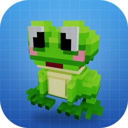
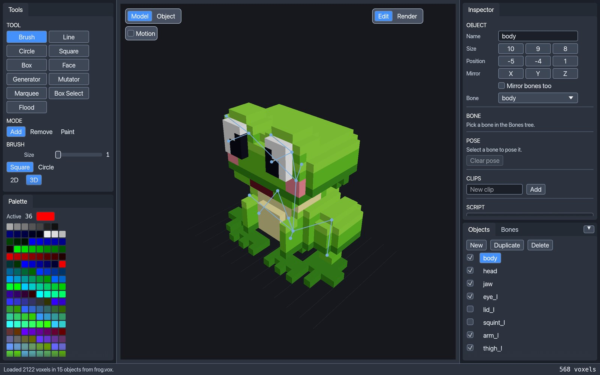
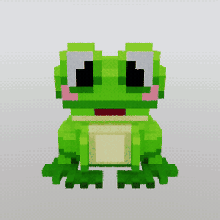
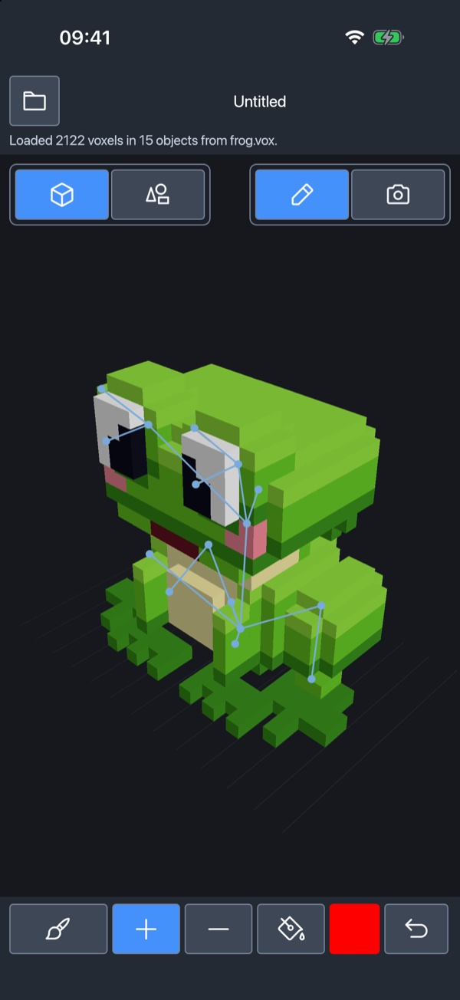
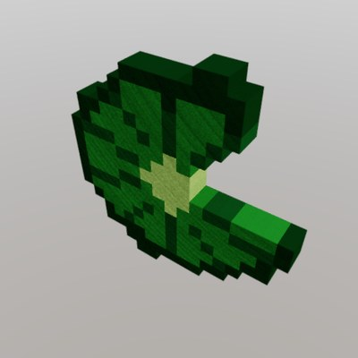
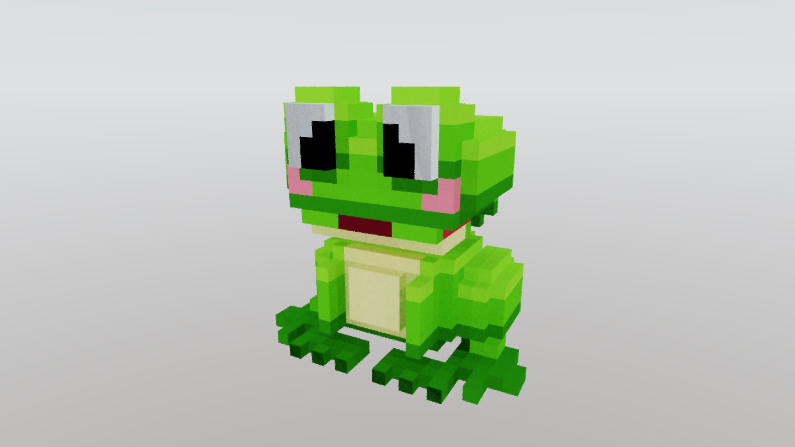
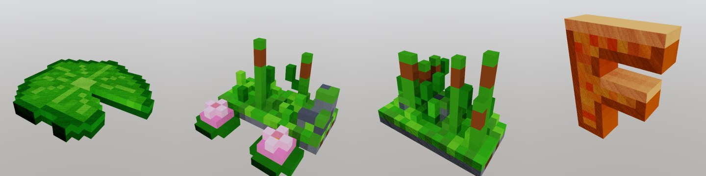

<p align="center"></p>

<h1 align="center">Froxel</h1>

<p align="center">
A voxel editor with a path tracer and an MCP server, written in Rust.<br>
macOS, Windows, Linux, FreeBSD, Android, and iOS.
</p>

<p align="center">
<a href="https://github.com/theromis/Froxel/releases/latest"><b>Download</b></a> ·
<a href="#mcp-let-an-agent-build-models">MCP</a> ·
<a href="#scripting">Scripting</a> ·
<a href="#godot-and-blender">Bridges</a> ·
<a href="#command-line">Command line</a> ·
<a href="#build-from-source">Build</a>
</p>



Froxel opens and saves MagicaVoxel `.vox` files, edits them with brushes, shapes,
and selections, path-traces them on the GPU, and exports glTF with bones and
animation clips. An AI agent can drive all of it through the built-in
[Model Context Protocol](https://modelcontextprotocol.io) server.

## Features

- **`.vox` in and out.** Keeps groups, layers, hidden objects, animation frames,
  and materials (`_diffuse`, `_metal`, `_glass`, `_emit`). Files saved by Froxel open
  in MagicaVoxel.
- **Editing.** Brush, line, circle, square, box, face fill, generators, mutators,
  marquee, box select, and flood select. Add, remove, and paint modes. Object mode
  moves, rotates, mirrors, and flips whole objects. Each stroke undoes in one step.
- **Characters.** Bones, rigid binding of objects to bones, poses, and animation
  clips, saved in the `.vox` file and exported to glTF.
- **Render mode.** A path tracer with sky, sun, metal, glass, and emission. It
  accumulates on the GPU through wgpu (Metal, Vulkan, DX12) and falls back to the
  CPU. Denoising is built in.
- **glTF export.** `.glb` with merged coplanar faces, no T-junctions, and a palette
  texture or vertex colours.
- **Scripts.** Objects can carry a sandboxed [Rhai](https://rhai.rs/) script with
  sliders for its parameters.
- **Bridges.** Godot and Blender can drive those sliders and import the mesh
  live, then bake a standalone scene. See [docs/bridges.md](docs/bridges.md).
- **Automation.** An MCP server for agents and a command line for batch renders.

<p align="center"></p>

## Install

Download the file for your system from the
[latest release](https://github.com/theromis/Froxel/releases/latest).

| System | File | Notes |
|---|---|---|
| macOS 11+ (Apple silicon and Intel) | `froxel-<version>-macos-universal.dmg` | Signed and notarized. Drag Froxel to Applications. |
| Windows (x64, x86, ARM64) | `froxel-<version>-windows-<arch>.zip` | Not signed yet ([why](CODE_SIGNING.md)). SmartScreen may ask once: choose **More info → Run anyway**. Windows 11 with Smart App Control on blocks it outright. |
| Debian, Ubuntu (x86_64, aarch64, riscv64) | `froxel-<version>-linux-<arch>.deb` | `sudo apt install ./froxel-*.deb` adds the menu entry and icon. Needs Vulkan. |
| Other Linux | `froxel-<version>-linux-<arch>.tar.gz` | Needs Vulkan and glibc 2.35 or newer (2.39 for riscv64). |
| FreeBSD (x86_64) | `froxel-<version>-freebsd-x86_64.tar.gz` | |
| Android 7.0+ (arm64) | `froxel-<version>-android-arm64.apk` | Open it on the phone. Android asks once to allow installs from the browser or file manager. |
| iOS 16+ simulator | `froxel-<version>-ios-simulator.zip` | Unzip and drag `Froxel.app` onto a booted simulator. The device build goes to the App Store. |
| Godot 4.3+ plugin | `froxel-<version>-godot-addon.zip` | Unzip into the project folder. See [Godot and Blender](#godot-and-blender). |
| Blender 4.2+ add-on | `froxel-<version>-blender-addon.zip` | Preferences → Add-ons → Install from Disk. |

Every release has a `SHA256SUMS.txt`. How the builds are signed is in
[CODE_SIGNING.md](CODE_SIGNING.md).

Try it on the frog, [`examples/frog.vox`](examples/frog.vox), or on the scripted
lily pad, [`examples/lily_pad.vox`](examples/lily_pad.vox).

## Phones and tablets



The Android and iOS builds are the same editor with a touch layout. The
viewport fills the screen. The strip at the bottom holds the tool, add, remove,
and paint, the colour, and undo. The tool settings, the palette, and the files
open as sheets above it. The bundled frog and lily pad are under the folder
button, and your own files are saved to the app's documents.

- **One finger** uses the active tool.
- **Two fingers** orbit and pinch to zoom. **Three fingers** pan.
- **Long-press the colour**, then tap a voxel, to pick its colour.

On a tablet 700 points wide or more, the desktop tools and palette sit on the
left instead of the strip.

<br clear="right">

## Controls

- **Right-drag** orbits. **Scroll** zooms. **Space-drag** or middle-drag pans.
- **Left-drag** uses the active tool.
- **V** brush, **L** line, **B** box, **F** face, **U** mutator, **M** marquee.
- **T** add, **R** remove, **G** paint. These three apply in Model mode.
- **Tab** switches Model and Object mode.
- In Object mode, **X / Y / Z** rotates the active object. **Shift** flips it.
- **⌘Z / ⇧⌘Z** undo and redo. **⌘C / ⌘X / ⌘V** copy, cut, and paste.
- **⌘N / ⌘O / ⌘S / ⇧⌘S** new, open, save, and save as.
- **⇧⌘E** exports a glTF `.glb` with a palette texture and merged faces.

On Windows and Linux, use **Ctrl** in place of **⌘**.

## MCP: let an agent build models

`froxel mcp` is a [Model Context Protocol](https://modelcontextprotocol.io) server.
An agent can create objects, place voxels, fill boxes and ellipsoids, set the
palette, add bones and clips, run scripts, export `.glb`, and path-trace a PNG
to check its work. The frog in these pictures was built this way.

Add it to Claude Code. On macOS, after installing from the dmg:

```sh
claude mcp add froxel -- /Applications/Froxel.app/Contents/MacOS/froxel mcp
```

Or add it to any MCP client's config:

```json
{
  "mcpServers": {
    "froxel": {
      "command": "/path/to/froxel",
      "args": ["mcp"]
    }
  }
}
```

Then ask for a model:

> Build a 16-voxel-tall voxel frog with big eyes and pink cheeks, give it a head
> and jaw bone, render it from the front, and export it to `frog.glb`.

`froxel mcp` works headless, with no window. To watch the edits happen, and let
the agent take screenshots and click controls, connect it to an open editor:

```sh
froxel mcp --connect 127.0.0.1:7979 --launch
```

`--launch` opens the window if it is not already running. The full tool list and
the connected mode are in [docs/mcp.md](docs/mcp.md).

Creatures and other one-off shapes are made by **hand sculpting**: block out
with box and ellipsoid fills, refine single cells, render after every step,
and compare with the reference. No script is stored. See
[docs/hand-sculpting.md](docs/hand-sculpting.md).

[skills/froxel/SKILL.md](skills/froxel/SKILL.md) is an agent skill that
explains when and how an agent should use these tools. To install it for
Claude Code, copy the `skills/froxel` folder into `~/.claude/skills/`.

## Scripting

An object can carry a [Rhai](https://rhai.rs/) script. The editor shows a slider
for each parameter, and **Regenerate** rebuilds the voxels. Scripts run in a
sandbox with no file, network, or clock access, and saved files keep the voxels,
so the `.vox` still opens in MagicaVoxel.



```rhai
let radius = param_float("radius", 8.0, 3.0, 16.0);
let seed = param_int("seed", 1, 0, 9999);

set_slot(1, [18, 72, 28]);   // a palette colour
// …for each cell inside a wobbly disc:
set(ix, 0, iz, slot);
```

The whole lily pad is [`examples/lily_pad.rhai`](examples/lily_pad.rhai). The
API is in [docs/scripting.md](docs/scripting.md).

## Godot and Blender

`froxel bridge` serves a `.vox` on `127.0.0.1`. A Godot node or the Blender
sidebar connects with the printed session file, shows a slider for each script
parameter, and imports the model as glTF, bones and clips included. Moving a
slider reruns the script. **Bake** writes an ordinary scene or Blender object
that no longer needs Froxel, and headless Godot can bake a list of variants in
one go. `--bridge PORT` serves the open editor instead, so edits in the window
show up in the next import.

```sh
froxel bridge --input examples/lily_pad.vox      # four sliders: radius, notch, direction, seed
froxel --bridge 29771 examples/lily_pad.vox
```

<p align="center">


</p>

The Godot plugin is [`godot/addons/froxel_bridge`](godot/addons/froxel_bridge) and
the Blender add-on is [`blender/froxel_bridge`](blender/froxel_bridge). Both are
in every release since 0.2.0 as `froxel-<version>-godot-addon.zip` and
`froxel-<version>-blender-addon.zip`. Tested with Godot 4.5 and Blender 5.2.
Setup, the variant baker, and the protocol are in [docs/bridges.md](docs/bridges.md).

## Command line

`froxel render` path-traces a `.vox` file to a PNG with no window. The CPU tracer is
the default, so a given seed always writes the same image. `--gpu` uses the wgpu
tracer.

```sh
froxel render --input examples/frog.vox --output frog.png \
  --width 1440 --height 810 --samples 256 --denoise --gpu \
  --yaw -62 --pitch 16 --distance 0.72
```



That command made this picture. `--help` lists every option: camera,
depth of field, sky, sun, glass mode, and albedo and normal passes. The turntable
above is 48 such renders, one every 7.5° of `--yaw`.



`froxel voxrt --input model.vox` loads a file, saves it, loads the save, and
checks that nothing changed: objects, palette, materials, scene graph, bones,
scripts, and motion. `--dump` prints the chunk tree instead.

## Build from source

You need [Rust](https://rustup.rs). On Linux, the editor loads Wayland or X11 and
Vulkan at run time, so the build needs no `-dev` packages.

```sh
git clone https://github.com/theromis/Froxel
cd Froxel
cargo run --release -- examples/frog.vox
```

The binary is `target/release/froxel`. On macOS the File and Edit commands live on
the application menu bar. Elsewhere, or with `FROXEL_NO_NATIVE_MENU` set, they are
in a menu strip at the top of the window.

`--features oidn` links [Open Image Denoise](https://www.openimagedenoise.org) for
`--denoise`. It needs the library on the build machine. Without it, Froxel uses
its built-in edge-aware filter.

The phone builds need the [Android NDK](https://developer.android.com/ndk) and
[cargo-apk](https://github.com/parasyte/cargo-apk), or Xcode on macOS:

```sh
cargo apk build --lib --features android-lib --release   # target/release/apk/froxel.apk
packaging/android/bundle.sh                               # Play bundle, froxel.aab (needs a JDK)
packaging/ios/bundle.sh                                   # simulator Froxel.app
```

Tests:

```sh
cargo test --bin froxel
```

What changed in each version is in [CHANGELOG.md](CHANGELOG.md). Releases are built
by a GitHub workflow. See [docs/releasing.md](docs/releasing.md).

## Thanks

Inspired by [MacVoxel](https://tangled.org/pa.ulst.ar/MacVoxel).

## License

MIT. See [LICENSE](LICENSE).
