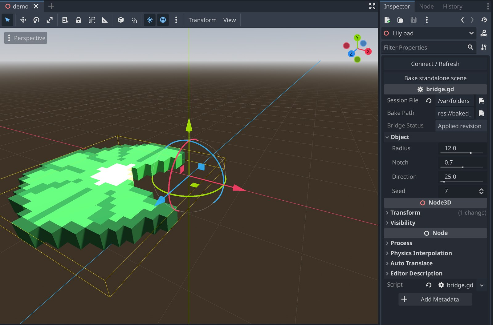
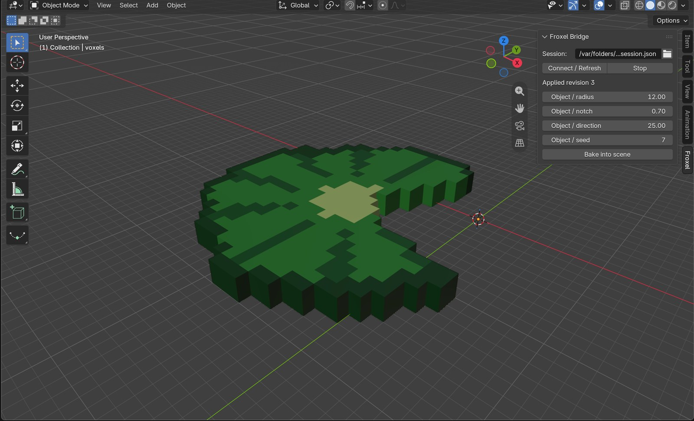

# Godot and Blender

The bridge is new in 0.2.0. Each release has the Godot plugin and the Blender
add-on as zips next to the Froxel downloads.

Froxel can serve the open document on `127.0.0.1`. Godot and Blender connect
as clients, edit the script parameters, and import a glTF. Bake keeps a plain
scene or a Blender object after Froxel stops.

The export is the same glTF as File → Export Mesh: Y-up, a palette texture,
bones, and clips when the document has them. From the editor, the bridge uses
the options on the Export panel. The headless command uses the defaults
(merged faces, palette texture, hidden objects left out, one mesh).

An `evaluate` reruns every object script, then writes the glTF. Hand edits on
a scripted object are replaced by that run. An object with no script is
exported as it is. Sending no values still reruns the scripts at their
current parameters. If a value is rejected or a script fails, the document
stays as it was.

## Headless

```sh
froxel bridge --input examples/lily_pad.vox
froxel bridge --input model.vox --port 0
```

`examples/lily_pad.vox` has a script with four parameters, so it is a good first
test. A model with no script, like `examples/frog.vox`, still imports but shows
no sliders.

The default port is 29771. `--port 0` binds a free port. The process prints

```text
FROXEL_SESSION=/tmp/froxel-bridge-…/session.json
```

and serves until it exits. Copy that path into Godot or Blender. Do not open
a session file from someone else: it contains the token, and the token is
checked on every request.

## Editor

```sh
froxel --bridge 29771 examples/lily_pad.vox
```

`FROXEL_BRIDGE_PORT` is the port when `--bridge` is omitted. The session path
is printed on stderr and shown in the status bar. Each `evaluate` from a
client is one undo step in the window. Voxel edits made in the window are
included in the next import.

## Godot



Unzip `froxel-<version>-godot-addon.zip` into the project folder. It creates
`addons/froxel_bridge`. Then enable Froxel Bridge in Project Settings →
Plugins. From a clone, copy `godot/addons/froxel_bridge` instead; `godot/` is
an example project with the plugin already enabled.

Create a Node3D of type **FroxelBridge**. Set **Session File** to the printed
path and click **Connect / Refresh**. Parameters show up under the object
name. A `floats`, `vec2s`, or `vec3s` parameter is a PackedFloat32Array,
PackedVector2Array, or PackedVector3Array in the inspector; a list that is too
long or out of range is reported in **Bridge Status**. Edits update the preview after a short pause. Set **Bake Path** and
click **Bake standalone scene**. The `.tscn` is a normal scene with embedded
resources. The bridge node does not poll during a running game.

### Bake settings

By default a bake is the glTF as it was imported: one unit per voxel, the
document's origin, and no collision. The **Bake** group on the node makes a
scene that is ready to place instead:

| Setting | Default | Effect |
|---|---|---|
| **Bake Voxel Size** | 1 | Metres per voxel. 0.04 makes a 25-voxel model 1 m. |
| **Bake Origin** | Source | Source keeps the document's origin. Center and Bottom Center use the bounds of the geometry, so a tree or a rock stands on its origin. |
| **Bake Apply Transform** | off | Bakes the node's own position, rotation and scale. The scene placed at the origin of another scene looks as the preview looks here. |
| **Bake Collision** | None | Adds a StaticBody3D with one BoxShape3D, or one upright CapsuleShape3D, around the bounds of the geometry after the settings above. |

The preview uses the voxel size and the origin, so what you see is what is
baked. With any setting changed, the scene has an unscaled root named
`BakedFroxel` with a `Visual` child (the geometry, carrying the scale and the
offset) and, with collision, a `Collision` child whose `Shape` is not scaled.
Placing the scene sets the root's position, so the offset is kept. Do not set
a voxel size and also scale the node with **Bake Apply Transform** on, or the
scale applies twice. The collision layer and mask are Godot's defaults; set
them on the instance. The shape is a simple bound, not the geometry: replace
it when a model needs a closer fit.

A bake is written beside the target as `<name>.baking.tscn` and moved over it
only when it is complete, so a bake that fails leaves the previous scene in
place.

Headless, one scene per object in `variants.json`. A value may be a parameter
name, `objectName/name`, or the id `index/name`. A bare name has to be unique.

```sh
godot --headless --path godot \
  --script res://addons/froxel_bridge/bake.gd -- \
  --session "$FROXEL_SESSION" \
  --out res://baked/pad_%d.tscn \
  --variants variants.json
```

```json
[
  {"radius": 8, "seed": 1},
  {"radius": 14, "seed": 2}
]
```

A list parameter takes a JSON list, for example
`{"shore": [[0, 0], [12, 4], [20, 3]]}` for a `vec2s`. A variant that is too
long or out of range stops the bake with the reason, and no scene is written
for it.

The same bake settings, headless. Without them the scenes are the raw import.
The headless node has no transform of its own.

```sh
godot --headless --path godot \
  --script res://addons/froxel_bridge/bake.gd -- \
  --session "$FROXEL_SESSION" \
  --out res://baked/pad_%d.tscn \
  --variants variants.json \
  --voxel-size 0.04 --origin bottom_center --collision box
```

`--origin` is `source`, `center` or `bottom_center`; `--collision` is `none`,
`box` or `capsule`.

From a script on a node that is already in the tree:

```gdscript
bridge.session_file = session_path
bridge.connect_bridge()
var error := await bridge.wait_schema()
error = bridge.set_parameter("radius", 12.0)
error = bridge.set_parameter("shore", [[0, 0], [12, 4]])
error = await bridge.bake_to("res://baked/pad.tscn")
```

The settings are properties of the node (`bake_voxel_size`, `bake_origin`,
`bake_apply_transform`, `bake_collision`), so a script sets them before
`bake_to`.

`wait_schema` and `bake_to` return `""` on success. They wait up to 300 seconds, the same deadline the server gives a script run; pass `timeout_msec` to change it.

Godot 4.3+ is the target and 4.5 is tested. The glTF import uses
`GLTFDocument`.

## Blender



Install `froxel-<version>-blender-addon.zip` from Preferences → Add-ons →
Install from Disk, then enable Froxel Bridge. From a clone, build the same zip
with

```sh
python3 tools/package_bridge.py
```

and install `dist/froxel_bridge.zip`. In the 3D View sidebar, open the **Froxel**
tab, choose the session file, and click **Connect / Refresh**. Sliders match
the script parameters and stop at their range. A list parameter is a text
field holding JSON, such as `[[0, 0], [12, 4]]`; the label gives its longest
length. **Bake into scene** duplicates
the current import under an empty named `FroxelBake` and leaves the live
preview in place.

Blender 4.2+ is the target and 5.2 is tested. The glTF importer add-on has to
be enabled, which it is by default.

## Protocol

One client at a time. The first request has to arrive within 5 seconds and
carry the right token, or the connection is closed, so a silent or unknown
peer cannot hold the slot. UTF-8 JSON objects separated by a newline, at most
65536 bytes per frame. TCP fragments are accepted. There are no shell
commands and no client-supplied paths.

The session file is mode 0600 on Unix:

```json
{"v":1,"host":"127.0.0.1","port":29771,"token":"…","root":"/tmp/froxel-bridge-…"}
```

Every request carries `v`, `id`, and `token`. `id` is a nonnegative integer
and must increase on that connection. A malformed frame closes the
connection. A well-formed request that fails returns `error` and leaves the
connection open.

```json
{"v":1,"id":1,"token":"…","op":"describe"}
{"v":1,"id":2,"token":"…","op":"evaluate","values":{"0/radius":8.0}}
```

Replies echo `v` and `id`:

- `schema`: `parameters`, each `{id, name, object, objectName, type, value, min?, max?, maxLen?}`
- `result`: absolute `path` of a glb inside the session directory
- `error`: `message`

`id` on a parameter is `objectIndex/name`. A bare name is accepted when only
one parameter has it.

Types:

| type | JSON | notes |
|---|---|---|
| `bool` | `true` / `false` | not coerced from a number |
| `int` | integer | inclusive `min` / `max` |
| `float` | number | inclusive `min` / `max` |
| `color` | `[r, g, b]` or `[r, g, b, a]` | components in 0..1; alpha is ignored |
| `floats` | `[a, b, …]` | every number in `min` / `max`; at most `maxLen` entries |
| `vec2s` | `[[x, y], …]` | each coordinate in `min` / `max`; at most `maxLen` points |
| `vec3s` | `[[x, y, z], …]` | each coordinate in `min` / `max`; at most `maxLen` points |

A frame is at most 65536 bytes, so keep the lists of one `evaluate` below
about 4000 numbers in all.

Omitted keys keep their current values. Unknown keys, a wrong type, or a
value outside the range is an error and does not write a new glb. The latest
eight glbs are kept. Stopping Froxel deletes the session directory, so bake
before stopping. On macOS, Linux, and FreeBSD that includes Ctrl-C and
SIGTERM. On Windows, Ctrl-C in the console leaves the directory in the temp
folder.

Refresh reconnects and asks for the schema again. The client does not
reconnect on its own.
