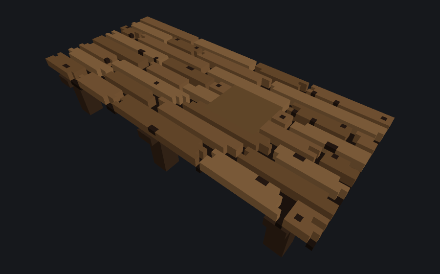
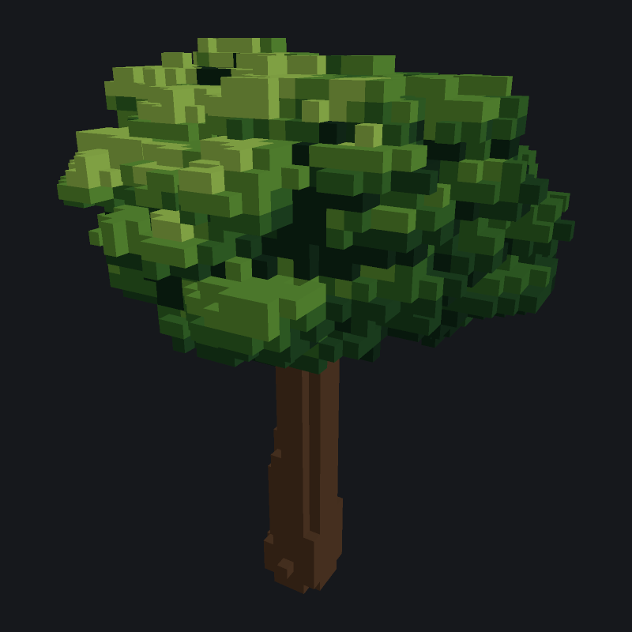
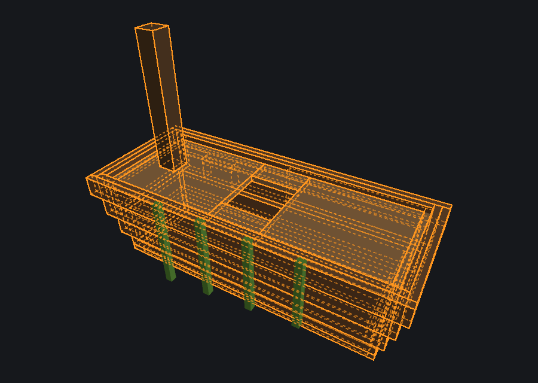

# Froxel MCP

`froxel` speaks the [Model Context Protocol](https://modelcontextprotocol.io)
on stdin/stdout. It is the editor in this repository.

| Server | Binary | Window | What an agent can do |
|---|---|---|---|
| Froxel | `froxel` | optional | Edit voxels, export glTF, and path-trace a PNG with `render`. Screenshot, inspect, and click the live window when connected. |

## Editor

`froxel mcp` is the Rust editor. Build it from the repository root:

```sh
cargo build
```

The binary is `target/debug/froxel` (or the path Cargo prints). Logs and
usage go to stderr. Stdout carries only protocol messages.

### Headless

```sh
froxel mcp
```

The session lives in this process. It starts empty: one object, the default
palette, no file path. No window opens. `screenshot`, `screenshot_viewport`,
`screenshot_region`, `ui_inspect`, and `ui_click` fail and say how to connect.
`froxel mcp --help`
prints usage and exits. Any other argument is an error, so a client that meant
to reach the window does not silently edit a private document.

```json
{
  "mcpServers": {
    "froxel": {
      "command": "/absolute/path/froxel",
      "args": ["mcp"]
    }
  }
}
```

### Docker

The `Dockerfile` at the repository root runs the headless server from a
release build, checked against `SHA256SUMS.txt`, on x86_64 or ARM64 Linux.
`FROXEL_VERSION` picks the release.

```sh
docker build -t froxel-mcp .
docker run -i --rm froxel-mcp
```

Files the server opens or writes are inside the container; mount a folder
with `-v` to reach them.

### Connected to the window

Start the editor with a control port. It listens on `127.0.0.1` only.

```sh
froxel --control 7979
froxel --control 7979 path/to/model.vox
```

`FROXEL_CONTROL_PORT` is the port when `--control` is omitted. A port on the
command line wins.

```sh
froxel mcp --connect 127.0.0.1:7979
```

`--connect` requires `HOST:PORT`. Without it, or with an unknown argument, the
process exits instead of falling back to a headless session. If nothing is
listening, startup fails.

`--launch` opens this same binary with `--control PORT` when the port is
closed, then waits up to 20 seconds. If the editor is already listening, it
connects and does not open a second window.

```json
{
  "mcpServers": {
    "froxel": {
      "command": "/absolute/path/froxel",
      "args": ["mcp", "--connect", "127.0.0.1:7979", "--launch"]
    }
  }
}
```

The editor writes an unguessable token to an owner-only file,
`froxel-control-<port>.token`, under `$XDG_RUNTIME_DIR` or `~/.cache`. The
MCP bridge reads that file itself. A request without the token is refused.
The path is printed on stderr when the port opens; the token is not.

Edits from a connected client appear in the open window. The headless session
and the window are different documents.

### Protocol

Newline-delimited JSON-RPC 2.0: one message per line, 16 MiB limit,
`initialize` first, `ping` before that, tool failures as `isError: true`.
The default revision is `2025-06-18`.
`2026-07-28`, `2025-03-26`, and `2024-11-05` are accepted and echoed back.

### Coordinates

Edits from the voxel tools apply to the **active object**, in that object's
**local** cells. `x` and `y` are horizontal, `z` is up. Add the object's
world `position` (the same three integers as `translation`) to a local cell
to get its world cell. `add_object` and `set_object` take that world
position; moving an object moves its voxels in the world and leaves the local
cells where they are. `position` is the world cell of local `(0, 0, 0)`, in a
new document and in a file just opened. MagicaVoxel stores `nTRN` `_t` at
the model centre, `SIZE / 2` with integer division. A rotation `_r`, and a
parent group's translation, turn that centre. Loading subtracts the rotated
centre offset so the SIZE corner stays local `(0, 0, 0)`. Saving adds the
offset back, so MagicaVoxel still opens the parts in place. Bone pivots are
fractional world coordinates: a joint may sit on a corner, a cell centre, or
anywhere between cells. Palette
index `0` is empty and erases a cell. Indices `1..255` are colors. A cell
must lie in `[-1024, 1024)`.

`space: "world"` gives a tool world cells instead. The handler subtracts the
active object's position (for `split_object`, the source's) before the tool
runs, and the reply's `x`, `y`, `z`, `cells`, `bounds`, and `origin` come
back in world cells, with `space` and `position` stated. So the same box
lands on the same place whichever part it is sent to, and stays right after
a save and reopen has moved the objects. `get_voxel`, `set_voxel`,
`set_voxels`, `get_voxels`, `fill_box`, `fill_ellipsoid`,
`fill_rounded_box`, `fill_tube`, `carve`, `smooth`, `loft`, `brush`,
`carve_from_views`, `project_paint`, `decal`, and `split_object` take it;
it moves corners `x0`..`z1`, cells `x`, `y`, `z`, `points`, `cells`,
`origin`, `boxes`, `exclude`, a decal's `point` and `ray` origin, and a
`mirror`'s `at`. `space: "local"` is the default. Other tools refuse
`world`. In a `batch` each item takes its own `space`.

`mirror` paints or edits both sides of a plane in one call. `set_voxels`,
`fill_box`, `fill_ellipsoid`, `fill_rounded_box`, `fill_tube` (any `mode`
but `intersect`), `recolor`, `surface_stroke`, `project_paint`, and `decal`
take it:
`true` (across x), an axis `"x"`, `"y"`, or `"z"`, or `{"axis": "x", "at":
16}`. `at` is the plane's coordinate in local cells (world cells with
`space` `world`), a multiple of 0.5: cell `c` spans `c..c+1`, so `at` 16
swaps cells 15 and 16 and `at` 16.5 keeps cell 16 on itself. Without `at`
the plane is the middle of the object's bounds along the axis. The tool
runs once on the object and once on the object reflected across the plane,
whose writes are reflected back: the far side's own surface is painted (a
head one cell fuller on the right still gets its stripe on its own skin),
and a picture comes out mirrored, a left eye for a right one. A cell both
sides write keeps the first side's slot. The reply adds `mirrored`, the
cells only the far side wrote. One undo step covers both.

```json
{"points": [[1, 8, 12], [3, 1, 13]], "palette": 3, "width": 1.5, "only": [2], "mirror": true}
```

```json
{"x0": 12, "y0": -6, "z0": 4, "x1": 15, "y1": -3, "z1": 6, "palette": 7, "mode": "paint", "space": "world"}
``` A write that would make the active object longer
than 256 on any axis is refused and changes nothing.

Every tool that writes a file (`save_file`, `render`, `model_view`,
`preview`, `compare_silhouette`, `export_mesh`, `export_models`,
`export_variants`, `bake_scene`, and the screenshots) creates the missing folders of its
path before writing, so a save into a fresh folder does not fail.

`save_file` writes every non-empty object. A new object is a normal model:
its own `SIZE`/`XYZI`, an `nTRN`/`nSHP` pair under the scene group, `_name`
on the transform, and the model centre in that transform, so MagicaVoxel
opens the parts in place. The reply is `path`, `voxels` (solid cells in the
whole file, not only the active object), and `objects` (models written).
An object with no voxels is omitted. A file that
had a scene graph is written back with that graph: groups, layers, hidden
objects, and animation frames after the first stay. Frame 0 takes the edited
translation, rotation, name, and `_hidden`. Each model is at most 256 cells
on an axis. A rotation read from the file is baked into the cells for editing
and written back as `_r`. Resizing that object keeps the rotation. A new
document, or a file with no scene graph, is saved as one group of objects.
`open_file` loads every object. `nTRN` translation and rotation are applied,
and `_hidden` on a node or an ancestor hides that object in the mesh and the
tracer. A file with no scene graph still loads its first model.

### Tools

| Tool | Required arguments | What it does |
|---|---|---|
| `new_document` | — | Empty document, default palette, cleared path and undo stack |
| `open_file` | `path` | Open a `.vox`, replacing the session. The reply is short: `path`, `objectCount`, `voxels`, `bounds`, `activeObject`, `canUndo`, `canRedo`, `bones` (a count), `paletteSlots` (used slots), `motionSlots`, the first 20 `objectNames`, and `moreObjects`, plus `sceneShift` and `sceneShiftNote` when world positions differ from the file's (see Saved scene coordinates). `detail` `full` replies with the `inspect_document` result instead (optional `fullPalette`) |
| `save_file` | — | Write every non-empty object. `path` overwrites the open file when omitted; its folder is created. Replies with `voxels` and `objects` |
| `inspect_document` | — | Path, counts, world bounds, objects (name and world position), the used palette slots, and the slots with motion. `fullPalette` lists all 256 slots |
| `get_voxel` | `x`, `y`, `z` | Palette index of one **local** cell of the active object. `0` is empty |
| `batch` | `operations` | Apply a list of editing tools in order as one undo step. Stops at the first error, names the item, and leaves the document as it was. Replies with `items`, `changed`, `voxels`, and each item's result in short form. Tools that write files are refused. See [Batch](#batch) |
| `set_voxel` | `x`, `y`, `z`, `palette` | Write one **local** cell. One undo step |
| `set_voxels` | `cells` | Write up to 200000 **local** cells as one undo step |
| `fill_box` | `x0`, `y0`, `z0`, `x1`, `y1`, `z1`, `palette` | Fill an inclusive box of **local** cells, at most 2000000, one undo step |
| `fill_ellipsoid` | `x0`, `y0`, `z0`, `x1`, `y1`, `z1`, `palette` | Fill the ellipsoid inscribed in that box. The box volume is checked first, even when the solid is smaller. One undo step |
| `fill_rounded_box` | `x0`, `y0`, `z0`, `x1`, `y1`, `z1`, `palette`, `radius` | Same box, with an edge bevel of `radius` voxels. `radius` 0 is the full box. The radius is clamped to half the shortest side |
| `fill_tube` | `points`, `palette` or `palettes` | Fill a tube through 2..=1024 **local** points, each with its own radius. Optional `radius`, `curve` (`polyline`, `smooth`), `aspect`, `roll`, `profile` (`round`, `blade`), `pattern` (`rings`, `stripes`, `random`), `period`, `sectors`, `seed`, `mode`. At most 2000000 cells, one undo step |
| `sweep` | `points`, `profile` or `width` and `height`, `palette` or `palettes` | Fill a 2D cross-section along 2..=1024 **local** points, kept perpendicular to the path, for curved walls, banks, and ledges. Each point may carry `twist` and `scale`. Optional `radius`, `curve` (`polyline`, `smooth`), `pattern` (`bands`, `rings`, `random`), `period`, `seed`, `mode`. `palette` `0` erases the solid cells it covers instead, for a slanted cut along a closed or curved outline (`mode` `empty` is refused with it). Replies with `cells` and `length`, and `removed` when erasing. At most 2000000 cells, one undo step |
| `trim_outline` | `outline` | Remove every solid cell outside a surface: a closed plan outline of `[x, y]` points moved inward by `inset`, one number or `[z, inset]` pairs per height. Optional `curve` (`polyline`, `smooth`), a box `x0`..`z1`, `only`, `skin` (a slot), `thickness`. Replies with `removed`, `painted`, `added`, and a `warning` when nothing was outside. One undo step |
| `loft` | `points`, `palette` or `palettes` | Fill a solid along 2..=1024 **local** points whose cross-section changes per point: an ellipse (`rx`, `ry`) turned by `roll`, cut flat by `flatTop`, with outline `noise` and `frequency`. Optional `radius` and the section fields as defaults, `curve` (`polyline`, `smooth`), `caps` (`flat`, `round`), `pattern` (`rings`, `stripes`, `random`), `period`, `sectors`, `seed`, `mode`. `palette` `0` erases the solid cells it covers instead, for a slanted cut along a closed or curved outline (`mode` `empty` is refused with it). Replies with `cells` and `length`, and `removed` when erasing. At most 2000000 cells, one undo step |
| `deform` | `op` | `bend`, `taper`, or `twist` the active object (or the cells of a box `x0`..`z1`) along `axis`, or `displace` its surface with 3D noise. Optional `axis`, `origin`, `length`, `center`, `angle`, `direction`, `start`, `end`, `amplitude`, `scale`, `octaves`, `seed`, `bias`. Slots are kept. Replies with `cells`, `result`, `added`, `removed`. One undo step |
| `brush` | `op`, `points` | Sculpt brush dabs along **local** points: `inflate`, `deflate` (`dig`), `smooth`, `flatten`, or `grab` (`drag`). Optional `radius`, `strength`, `falloff` (`smooth`, `linear`, `constant`), `only`, `palette`, `vector` (grab), `spacing`. Replies with `dabs`, `added`, `removed`. One undo step |
| `carve_from_views` | `views` | Fill the visual hull of 2 to 6 orthographic views (front, side, top) of a concept's turnaround sheet into the active object: each view's silhouette is extruded along its depth axis and the cells every view covers are kept. A view's `depth` (or the top-level `depthPath`), a grey depth map with white near, carves away the cells in front of its surface, so a round head is round; one view with depth is enough. See [Depth maps](#depth-maps). A view is a PNG `path` with `crop`, `background` (`auto`, `alpha`, or a key colour with `tolerance`), and `cellsPerPixel` or `size`, or `rows` with a `legend`. Optional `path`, `background`, `tolerance`, `alphaThreshold` (for every view without its own), `depthPath`, `depthTolerance`, `size`, `origin`, `cellsPerPixel`, `palette` or `slots`, `coverage`, `shell`, `smooth`, `mode`. Replies with `cells`, `bounds`, `size`, and each view's `grid`, `covered`, and `depth` (its calibration and the cells it carved). At most 4000000 cells in the box, one undo step. See [Silhouettes](#silhouettes) |
| `orient_to_views` | `views` | Turn the active object to the axis-aligned turn (of 24, or 4 with `turns` `upright`), plus fine steps (`yawStep`, `yawRange`, `fineAxes`), whose silhouettes best match a views sheet by IoU, and scale it (`size`, `height`, or `scale`). Views as `fit_to_views` takes them, with `weight`. Optional `resolution`, `apply` (false only reports). Replies with `before` and `after` (`score`, per-view `iou`), `rotation` (`euler`, `axes`, `yaw`, `fine`, `matrix`), `candidates`, `margin`, `scale`, `cells`, `bounds`. One undo step. See [Turning a mesh to the views](#turning-a-mesh-to-the-views) |
| `import_mesh` | `path` | Voxelize a `.glb`, `.gltf`, or `.obj` (with its `.mtl` and textures) into the active object, or a new one with `newObject` (and `name`). Optional `size`, `scale`, or `voxelSize`; `upAxis`, `rotation`, `position`, `anchor` (`min`, `center`, `bottom`), `fill` (`solid`, `parity`, `shell`), `colors` (`auto`, `vertex`), `palette` or `slots`, `maxNewSlots`, `tolerance`, `mode`, `orient` (turn the mesh to a views sheet first, see [Turning a mesh to the views](#turning-a-mesh-to-the-views)). Replies with `cells`, `shell`, `interior`, `openEdges`, `written`, `changed`, `slots`, `newSlots`, `bounds`, `scale`, `triangles`, `primitives`, `textures`, `warnings`. At most 256 cells per axis and 2000000 cells, one undo step |
| `components` | | The connected parts of the active object, for a generated mesh that came with extras. `op` `list` (default), `keep_largest` (`keep`, default 1), `remove_small` (`minCells`), or `delete`, `move` (`offset`), `split` (`name` or `into`, `copy`, `makeActive`, `index`) of the part holding `seed`; with `anchor`, that part is first cut at its thinnest neck from the anchor's. Optional `connectivity` (6, 18, 26, the default), `reach` (default 8), `radius`. Replies with `count`, `largest`, `components`, `selected`, `seed`, `anchor`, `cut`, `changed`, `voxels`. One undo step. See [Cleaning up a generated mesh](#cleaning-up-a-generated-mesh) |
| `surface_stroke` | `points`, `palette` | Paint a stroke through 2..=1024 **local** points that snaps to the active object's nearest surface cells: seams between shell plates, markings on a curved body. Optional `curve` (`polyline`, `smooth`), `width` (cells across, default 1), `depth` (cells into the solid, default 1), `reach` (default 8), `only`, `mirror`. `palette` `0` cuts a groove. Replies with `cells`, `changed`, `samples`, `missed`, `snap`, `length`, `voxels`. One undo step |
| `shell_plates` | `palettes` | Paint a turtle-shell plate pattern over the active object's dome: a central plate, `rings` of plates, an outer `band` of `bandCount` plates, and a `rim`, split by seams `seamWidth` wide in the `seam` slot or grooved `seamDepth` deep with `seam` 0. Placed by distance along the surface from the apex, on the surface cells facing up within `facing` (default 80). Optional `layout` (`rings`, `voronoi`), `central`, `band`, `bandCount`, `rim`, `center`, `depth`, `zRange`, `x0`..`z1`, `only`, `jitter`, `symmetric`, `seed`. Replies with `cells`, `changed`, `taken`, `unreached`, `plates`, `seams`, `apex`, `kinds`, `voxels`. One undo step |
| `recolor` | `from` and `to`, or `map` | Replace palette slot `from` with `to` (or every pair of `map`, `{"3": 5}` or `[[3, 5]]`) in the active object's solid cells, inside an inclusive box `x0`..`z1` or everywhere (with `mirror`, the box and its mirror). No cell is added; `to` `0` erases. Replies with `matched`, `changed`, `voxels`. One undo step |
| `carve` | `shape` | Remove the solid cells inside a `box`, `ellipsoid`, `rounded_box`, or `tube`, given as for the fill tools. To cut a polygon or rounded rectangle along a path, call `sweep` with `palette` `0`. Replies with `removed`. One undo step |
| `break_end` | `point`, `normal` | Break the active object across a plane: a jagged face, bark on its rim, sapwood inside, and tapered splinters out along the normal. Optional `depth`, `splinters` or `density`, `length`, `thickness`, `taper`, `rimBias`, `bark`, `sapwood`, `tips`, `seed`. One undo step |
| `scatter` | `x0`, `y0`, `z0`, `x1`, `y1`, `z1`, `palettes` | Drop small pieces (shard, chip, pebble, chunk) that settle on what is below into a heap. Optional `count`, `kinds`, `size`, `seed`, `floor`, `clump`, `exclude`. One undo step |
| `column_relief` | `x0`, `y0`, `z0`, `x1`, `y1`, `z1`, `facing`, `palette` | Break a cliff face into columns of random width that stand out of it and end at uneven heights around the crown. Optional `width`, `out`, `crown`, `top`, `lower`, `depth`, `exclude`, `seed`. Replies with `columns`, `added`, `removed`, `crown`. One undo step |
| `joints` | `x0`, `y0`, `z0`, `x1`, `y1`, `z1`, `pattern` | Cut real joint gaps into the solid cells of the box: `columns`, `courses` (running bond), or `cracks`. Optional `spacing`, `course`, `width`, `depth`, `dirt`, `only`, `exclude`, `density`, `seed`. Replies with `removed` and `dirtied`. One undo step |
| `weather` | `x0`, `y0`, `z0`, `x1`, `y1`, `z1` | Chip edges and corners, dent pits into flat faces, and add subtle colour noise on the exposed cells of the box. Optional `chip`, `chipSize`, `pits`, `pitDepth`, `broken`, `noise`, `noiseDensity`, `noiseScale`, `only`, `exclude`, `seed`. Replies with `chips`, `pits`, `removed`, `broken`, `recoloured`. One undo step |
| `bark` | `x0`, `y0`, `z0`, `x1`, `y1`, `z1`, `axis` or `points`, `palettes` | Bark on wood along the grain: long plates of varied width, offset like real bark, split by fissures cut 1 to 2 cells deep with `dirt` at their bottom, and now and then a crack across a plate; a flat plate gets them across its surface. Optional `curve`, `dirt`, `width`, `length`, `depth`, `cracks`, `only`, `exclude`, `seed`. Replies with `plates`, `removed`, `dirtied`, `painted`, `cracks`, and `warning` when a shape could not be cut. One undo step |
| `planks` | `x0`, `y0`, `x1`, `y1`, `z`, `axis`, `palettes` | A deck of separate boards over a rectangle at a height: rows of varied width, end joints staggered between neighbouring rows, gaps open down to a `dirt` cell, a tone per board, never one uniform stripe. Optional `dirt`, `dark`, `width`, `length`, `gap`, `thickness`, `ragged`, `nails`, `knots`, `only`, `exclude`, `seed`. Replies with `rows`, `boards`, `joints`, `added`, `painted`, `removed`, `dirtied`, `nails`, `knots`, `changed`, `voxels`. One undo step |
| `cavity_tint` | `x0`, `y0`, `z0`, `x1`, `y1`, `z1` | Darken exposed cells in concave spots and crevices, and with `lighten` lighten ridges, by neighbour occupancy, to the slots in `pairs` or to shades it makes in free slots. Optional `radius`, `dark`, `lighten`, `light`, `pairs`, `darken`, `brighten`, `only`, `exclude`. Replies with `darkened`, `lightened`, `shades`. One undo step with the palette |
| `foliage` | `palettes`, and `ellipsoids`, `boxes`, or `from` | A clustered broadleaf crown: separate leaf clumps packed over the volume's surface, each a flattened ragged ellipsoid shaded as one piece (sunlit top, dark underside, a darker seam where two meet), with a dark `core` inside that shows in the gaps; the wood is left alone. Optional box `x0`..`z1`, `core`, `size`, `gap`, `flatten`, `ragged`, `light`, `dark`, `sun`, `masses`, `groove`, `protect`, `exclude`, `seed`. Replies with `clumps`, `masses`, `added`, `recoloured`, `removed`, `core`. One undo step |
| `moss` | `x0`, `y0`, `z0`, `x1`, `y1`, `z1`, `palettes` | Moss caps on tops and curtains with a ragged end down the side faces below them, or with `style` `cushions` separate cushions on exposed cells with drapes from overhangs. Optional `style`, `amount`, `noise`, `faces`, `facing`, `band`, `only`, `exclude`, `layer`, `curtains`, `length`, `thickness`, `size`, `gap`, `exposure`, `drapes`, `seed`. `faces` defaults to top and side, or every face when `facing` is set; caps take undersides with `bottom`, and a `facing` that no face in `faces` points along is an error. Replies with `added`, `painted`, and `curtains`, or `cushions` and `drapes`, plus `warning` (why) when nothing grew. One undo step |
| `algae` | `x0`, `y0`, `z0`, `x1`, `y1`, `z1`, `palettes` | An algae band, dense at the bottom of `band` and thinning upward in clumps. Optional `band`, `amount`, `noise`, `faces`, `facing`, `only`, `exclude`, `layer`, `seed`. Replies with `added`, `painted`. One undo step |
| `vines` | `x0`, `y0`, `z0`, `x1`, `y1`, `z1`, `palettes` | Vine strands hanging from top edges, graded through `palettes` to the tip, with optional `blooms`. Optional `amount`, `length`, `bloomChance`, `noise`, `faces`, `facing`, `band`, `only`, `exclude`, `seed`. Replies with `added`, `strands`, `blooms`. One undo step |
| `smooth` | `x0`, `y0`, `z0`, `x1`, `y1`, `z1` | Majority filter in an inclusive box of at most 2000000 cells that keeps colours. Optional `iterations` (1..=8), `fillAt`, `removeAt`. Replies with `filled`, `removed`, `iterations`. One undo step |
| `get_voxels` | `x0`, `y0`, `z0`, `x1`, `y1`, `z1` | Non-empty **local** cells inside an inclusive box, at most 100000 |
| `set_palette` | `index` and `color` or `r`, `g`, `b`; or `entries` | Replace one slot, or many via `entries`, as one undo step. `color` is `"#rrggbb"` or `"#rrggbbaa"` (or `[r, g, b, a?]`), as the other tools take colours. `a` defaults to 255. Optional `motion` (`none`, `sway`, `bob`) and `motion_amount` (0..4) |
| `set_active_object` | `index` | Edit a different object. Later voxel tools use its local cells |
| `add_object` | — | Empty object. Optional `name`, world `position` `[x, y, z]` (default `[0, 0, 0]`), `size` `[x, y, z]` (capacity hint, each axis 1..=256), `make_active` (default true). Returns the index. One undo step |
| `set_object` | `index` | Optional `name`, world `position`, `hidden`. Moving changes the scene-graph translation, so voxels move in the world. One undo step |
| `remove_object` | `index` | Remove the object and its voxels. Its bone stays; the binding goes. Later indices decrease by one. Refuses the last object. One undo step |
| `mirror_object` | `index`, `axis`, `name` | Copy the object mirrored across `x`, `y`, or `z` through the origin. Optional world `position` and `mirrorBones` (default false). Replies with the copy's `index`, `name`, `bones`, and world `position`. One undo step |
| `clear_object` | — | Empty an object (`index`, an index or a name; default the active one) of every cell, with no box limit. Its name, position, bone, script, and markers stay. Replies with `index`, `name`, `removed`, `voxels`. One undo step; an empty object adds none |
| `split_object` | `boxes` or `slots` | Move (or `copy`) the cells of an object (`index`, an index or a name; default the active one) inside one or more inclusive local boxes, or of some `slots`, or both, into a new object (`name`) or an existing one (`into`), each cell keeping its world position. `invert` takes the rest. `makeActive` selects the target. Replies with `target`, `name`, `created`, `cells`, `replaced`, `position`, `sourceVoxels`, `targetVoxels`, `bounds`. One undo step |
| `add_bone` | `name`, `pivot` | Add a bone. `pivot` is a fractional world coordinate `[x, y, z]`. Optional `parent` (omit or null for a root) and `rotation` quaternion `[x, y, z, w]` (default identity `[0, 0, 0, 1]`). One undo step |
| `set_bone` | `name` | Optional `parent` (null makes a root; omit leaves it), world `pivot`, `rotation` `[x, y, z, w]`, `rename`. `joint: true` measures the pivot at the joint with the parent's part instead, as `place_joints` does (with `snap` and `band`). One undo step |
| `place_joints` | — | Put bone pivots (`bones`, default every bone) at the joints between their bound parts and their parents' parts: the overlap, the contact faces, or the nearest band (`band`, default 0.5 cells past the closest gap). `snap` `none`, `corner`, `center`, or `half`. Replies with `placed` [{`name`, `parent`, `pivot`, `previous`, `method`, `samples`, `gap`}] and `skipped` [{`name`, `reason`}]. One undo step |
| `remove_bone` | `name` | Delete a bone. Objects bound to it become unbound. Children keep its parent. One undo step |
| `bind_object` | `index`, `bone` | Bind an object to one bone, or `bone: null` to unbind. Rigid: one bone, weight 1. One undo step |
| `list_bones` | — | Each bone's parent, world pivot, quaternion, and the object indices bound to it |
| `set_pose` | `pose` | Preview pose. Map of bone name to a local quaternion `[x, y, z, w]`, or `{rotation, scale}`, on top of the bind pose. One undo step. Does not write the bind rotation |
| `clear_pose` | — | Remove the preview pose. One undo step |
| `add_clip` | `name` | Empty named clip. One undo step. Saved in the `.vox` `MVAN` chunk |
| `set_clip_keys` | `name`, `bone`, `keys` | Replace one bone's keys. Each key is `time`, optional `rotation`, `translation`, `scale`. One undo step |
| `list_clips` | — | Clips and their bone keys |
| `remove_clip` | `name` | Remove a clip. One undo step |
| `undo` | — | Undo the last edit |
| `redo` | — | Redo the last undone edit |
| `render` | `path` | Path-trace the scene to a PNG. The camera fits the visible cells (or `target`) in the frame. `width` and `height` default to 256 (up to 4096, 4096 × 2048 pixels in all); one alone and the other follows the model. `samples` defaults to 16. `bounces` defaults to 4. `denoise` defaults to true. `yaw` defaults to 30°, `pitch` to 25°. Optional `zoom`, `margin`, `target`, `distance`, `orthographic`, `views`, `pose`, `showBones` |
| `model_view` | `path` | Flat model view PNG: each pixel is the palette colour of the first cell hit, no light, no tonemap. Fitted like `render`. `width` and `height` default to 512 (up to 4096). Orthographic by default. Optional `view`, `yaw`, `pitch`, `zoom`, `margin`, `target`, `pixelsPerVoxel`, `distance`, `orthographic`, `background`, `views`, `pose`, `showBones` |
| `preview` | `path` | Fast lit PNG: the viewport's mesh and light rasterised on the CPU in well under a second, fitted to the model or one object with a margin. `width` and `height` default to 1024 (up to 4096). Optional `view`, `yaw`, `pitch`, `preset` (`game`: orthographic, yaw −135, pitch 32), `presets` (an object or a JSON file; the user's `camera_presets.json` is read too), `placementYaw` (the asset's turn about up where it is placed in a level), `orthographic`, `fov`, `margin`, `object`, `isolate`, `background`, `antialias`, `pose`. `inputs`, `variants`, or `reference` (with `columns`, `labels`) make a labelled contact sheet of several models and a concept image. `overlay` (`true`, or `boxes`, `points`, `connectors`) draws the markers over the model with their names (`overlayLabels`). `lighting` (`old_pond`, or a name from `lightingPresets` or the user's `lighting_presets.json`, or fields: sun direction, colour, and energy, ambient colour and energy, exposure, background, a LUT) lights it as a game does. Replies `previewTriangles` (the unmerged mesh it draws) and `export` (`triangles` and `quads` that `export_mesh` writes with the options in `export`, such as `colorAtlas`); `countsLabel` writes both on the image. See [preview.md](preview.md). `glb` draws a written `.glb` instead of the document, unlit, as a game draws a baked file |
| `project_paint` | `view` or `yaw` + `pitch`, `path` or `rows` | Recolour the active object's existing surface from one image projected along a view: never adds or removes cells. The image is a PNG `path` with `crop`, `background`, `tolerance`, `alphaThreshold`, `flip`, or `rows` with a `legend`; background pixels leave the surface alone. Optional `origin` and `size` (the box that may be painted; defaults to the object's bounds), `cellsPerPixel` or `imageSize`, `palette` or `slots`, `coverage`, `depth` (cells below the visible surface, default 1), `normalLimit` (degrees; steeper surfaces are skipped), `only` (slots that may be repainted), `mirror` (both sides of a plane). Replies with `cells`, `changed`, `bounds`, `origin`, `size`, `grid`, `covered`, `rays`, and `steep`. One undo step. See [Silhouettes](#silhouettes) |
| `decal` | `point` or `ray`, `size`, `path` or `rows` | Lay one picture onto the active object's curved surface around a point, so it keeps its size and shape on a round head: the surface is unrolled around the point and each surface cell takes the picture's ink under it. `ray` `{origin, direction}` takes the first solid cell instead. Optional `up` (default +Z), `crop`, `background`, `tolerance`, `flip`, `legend`, `palette` or `slots`, `coverage`, `depth` (cells into the solid, default 1), `reach` (default 8), `normalLimit` (degrees from the point's normal, default 90), `only`, `mirror`. Never adds or removes cells. Replies with `cells`, `changed`, `bounds`, `centre`, `normal`, `grid`, `covered`, `missed`, `reached`. One undo step. See [Silhouettes](#silhouettes) |
| `compare_silhouette` | `path`, `concept` | Compare the model's `preview` silhouette from a camera (`preset`, `presets`, `placementYaw`, `view`, `yaw`, `pitch`, `orthographic`, `fov`, `margin`, `object`, `isolate`, `pose`) with a mask cut from a concept PNG (`crop`, `background`, `tolerance`, `alphaThreshold`, `flip`) and cleaned by the [mask edits](#masking-a-concept) (`excludeColors`, `excludeTolerance`, `flood`, `mask`, `erase`, `keepLargest`; the reply's `maskEdits` counts them). `align` `fit` (default), `height`, `width`, or `{scale, offset}` places the concept with one uniform scale. Replies with `iou`, `missing`, `excess`, `pixels`, `align`, `conceptBounds`, `modelBounds`, and `aspect`, and writes an overlay PNG. Optional `width`, `height`, `lighting`, `antialias`. See [Silhouettes](#silhouettes) |
| `measure_sheet` | `path` | Read a views sheet image, writing nothing: each view's tight `crop` (connected inked regions under the background rule and the mask edits, merged within `gap` pixels, regions under `minShare` of the largest in `ignored`), the 2 x 2 `layout` names (front, side, top, back), the cube pitch per view (`pitchX`, `pitchY`, `strength`, `cubes`, `square`) from the autocorrelation of the cube seams, `checks` (front height = side height, front width = top width, side length = top length, in percent of pixels and of cubes, `ok` within `checkTolerance`), `fitViews` for `carve_from_views` and `fit_to_views`, and with `parts` the top view's parts sticking out of its body. See [Measuring a sheet](#measuring-a-sheet) |
| `set_view` | — | Move the session camera; connected, the window's. Optional `view`, `yaw`, `pitch`, `preset`, `presets`, `placementYaw`, `frame`, `distance`, `orthographic`, `bones`. Not an edit |
| `screenshot` | — | PNG of the whole editor window. Connected mode only |
| `screenshot_viewport` | — | PNG of the 3D viewport, including its mode chips. Connected mode only |
| `screenshot_region` | `x`, `y`, `width`, `height` | PNG of a rectangle in window points. Connected mode only |
| `ui_inspect` | — | Previous frame's controls, tool, mode, active object, voxel count, and status. Connected mode only |
| `ui_click` | `x`, `y` | Click the topmost registered control. A viewport hit stamps the active tool. A slider sets its value from the point. A palette cell selects that slot. Connected mode only |
| `set_marker` | `name` | Name a point, a collision box, or a connector on an object: `kind` (`point`, `box`, `connector`), `point`, the box's inclusive cells `x0`..`z1`, `direction`, `object`. Saved in the `.vox` and exported as a glTF node. A marker of the same name is replaced. One undo step |
| `remove_marker` | `name` or `all` | Remove one marker, or every marker. One undo step |
| `list_markers` | — | Markers with `local`, `world`, and `gltf` coordinates |
| `collision_from_voxels` | — | Collision box markers from an object's solid cells, keeping hollows open: `prefix` (default `<object>_collider`), `holeSize` (default 3), `layer` or `zBands`, `minFeature`, `only`, `exclude` (slots), `maxBoxes`, `object`. A rerun replaces that prefix's boxes on the object. One undo step. Replies with `boxes`, `coveredPercent`, `emptyFilledCells`, `emptyFilledPercent`, `dropped`, and the cell counts |
| `export_mesh` | `path` | Write a glTF 2.0 `.glb` of every object. `merge` defaults to false. `vertexColors` defaults to false. `exportHidden` and `splitObjects` default to false. A slot with motion adds `TEXCOORD_1`. Clips become glTF animations. Markers become nodes. The reply includes `quads`, `triangles` (every triangle in the glb), `structure`, and `markers`. `bake` (with `colorAtlas`) paints ray-traced occlusion and a sun with shadows into the atlas, to draw unshaded |
| `export_variants` | `variants`, `dir` | Bake the scripted document once per parameter set `{name?, params}` and write `<name>.vox` and `<name>.glb` into `dir` with the `export_mesh` options, then merge them by name into a manifest (default `dir/variants.json`) of each set's parameters, markers, and bounds; the reply names the entries `added`, `replaced`, and `kept`. Optional `manifest`, `replace` (a fresh manifest), `vox`, `timeoutSeconds`. The document and its undo history stay as they were |
| `export_models` | `models` | Write 1 to 16 `.glb` files. Each item is `{path, source?, merge?, vertexColors?, exportHidden?, splitObjects?, colorAtlas?, aoStrength?, aoRadius?, aoTarget?, bake?}`. `source` is a `.vox` opened in its own session, so the open document stays. Each file's reply has `quads`, `triangles`, and `structure`: nodes, meshes, skins, animations, and warnings |
| `bake_scene` | `scene`, `path` | Bake a placement of many `.vox` files together into one `.glb` with one colour atlas, each shaded by its neighbours and by ground, to draw unshaded. Optional `bake`. Replies with `triangles`, `vertices`, `atlas`, `texels`, `bytes`, `memory`, `bake`, and `structure` |
| `set_script` | `source`, optional `object` | Store a Rhai script and read its parameters. One undo step. Does not rebuild voxels |
| `get_script` | optional `object` | Source, auto flag, and parameters |
| `set_params` | `values`, optional `object` | Set parameter values by name. One undo step. Does not run the script |
| `list_params` | optional `object` | Parameters from the last successful run |
| `regenerate` | optional `object` | Run the script. One undo step. A failure leaves voxels unchanged and names the script line |

`set_voxels` accepts each cell as `{"x","y","z","palette"}` or as
`[x, y, z, palette]`. A later duplicate of the same coordinate wins. Cells
that already hold the requested index are not an undo step.

`fill_box` corners may arrive in either order. The box is inclusive.
By default every fill writes every cell inside its shape, empty ones
included. `mode` changes that on `fill_box`, `fill_ellipsoid`,
`fill_rounded_box`, and `fill_tube`: `replace` (the default) writes every
cell, `empty` writes only empty cells so existing detail stays, `paint`
recolours only cells that are already solid, and `intersect` keeps only the
object's solid cells inside the shape, as they are, and erases every other
solid cell (`palette` is not needed then): a boxy visual hull cut to an
ellipsoid dome, or a blockout trimmed to a rounded box. `intersect` never
adds a cell, so a shape larger than the object changes nothing.

```json
{"x0": 0, "y0": 0, "z0": -9, "x1": 21, "y1": 27, "z1": 8, "mode": "intersect"}
```
`fill_ellipsoid` and `fill_rounded_box` use that same inclusive box. A cell
is solid when its centre lies inside the shape. The ellipsoid is centred on
the box and touches the middle of each face. `fill_rounded_box` measures
the distance from the cell centre to the box inset by `radius`. Both refuse
a box larger than 2000000 cells before writing, and both are one undo step.

`surface_stroke` draws on the surface instead of through space, so a seam or
a marking on a curved body needs no tube radius guessed to reach it. The
path through `points` (straight, or a Catmull-Rom curve with `curve`
`smooth`) is sampled every half cell, and each sample snaps to the nearest
surface cell, a solid cell with an empty face neighbour, within `reach`
cells (default 8): the points may float above the shell or sink into it.
Where two snapped cells do not touch, as on a steep side, the cells between
them snap too, so the line has no gap. Every solid cell within `width / 2`
of a snapped cell (`width` 1, the default, is a one-cell line) and at most
`depth` cells into the solid (1, the default, is the surface alone) takes
`palette`; `palette` `0` erases them, a groove `depth` deep. `only` limits
it to cells of those slots, so a seam on the shell stops at the skin.
Nothing is added. `missed` counts samples with no surface within reach and
`snap` is the farthest a sample moved.

```json
{"points": [[2, 14, 9], [11, 14, 11], [20, 14, 9]], "curve": "smooth", "palette": 5, "width": 1, "only": [3]}
```

`shell_plates` paints a turtle-shell-like plate pattern over a dome in one
call, instead of one `surface_stroke` per seam: a central plate (`central`,
its share of the dome's radius, default 0.22; 0 for none), rings of plates
(`rings`, plates per ring from the centre out, default `[6]`), an outer
band (`band`, its share, default 0.15, of `bandCount` plates, default twice
the last ring's; 0 is one unbroken band), and a rim (`rim`, cells at the
edge, default 1). `palettes` gives each kind its slot or slots (`ring` and
`seam` required; `central` and `band` default to `ring`, `rim` to `band`),
and each plate picks one by `seed`. Seams are `seamWidth` cells wide
(default 1) in the `seam` slot, or with `seam` 0 a groove `seamDepth` cells
deep; the rim takes none. It works on the surface, not on a view: the cells
taken are the surface cells whose normal is within `facing` degrees of
straight up (default 80), optionally inside a box `x0`..`z1`, a `zRange`
`[z0, z1]`, and the `only` slots. Each one's place is its distance along
the surface from the apex (the highest cell near `center`, default the
middle of the taken cells in plan) over that distance out to the dome's
edge in its direction, so the rings keep their width down the steep sides
of a tall or oval dome and nothing streaks as a top projection does.
`layout` `rings` cuts each ring into sectors whose boundaries `jitter`
moves (default 0.25 of a plate) and staggers ring to ring; `voronoi` gives
each cell the nearest of seeds laid out in the rings, for rounder,
irregular plates. `symmetric` (default true) mirrors boundaries, seeds, and
slot picks across the plane through the centre along y, so a shell facing
−Y has matching left and right plates. `depth` paints plates that many
cells in along the normal. `unreached` counts taken cells not joined to the
apex along the surface, which are left alone; `kinds` counts the surface
cells of each kind.

```json
{"palettes": {"ring": [3, 4, 5], "central": 7, "band": [4, 5], "rim": 8, "seam": 6},
 "rings": [5, 9], "bandCount": 16, "jitter": 0.3, "seed": 3}
```

`recolor` changes slots, never the shape: every solid cell whose slot is in
the map takes its new slot, so a blockout slot becomes the shell slot or two
shades merge without `weather` noise or a fill in `paint` mode. `from` and
`to` replace one slot; `map` gives several, as `{"3": 5, "4": 6}` or
`[[3, 5], [4, 6]]`, each slot at most once. The map applies to the cells as
they were, so `{"3": 4, "4": 3}` swaps two slots. All six corners `x0`..`z1`
limit it to an inclusive box; none is the whole object. `to` `0` erases those
cells. `matched` counts the cells of a mapped slot, `changed` those that
changed.

```json
{"map": {"3": 6, "4": 6}, "x0": 0, "y0": 0, "z0": 0, "x1": 21, "y1": 27, "z1": 1}
```

`fill_tube` takes `points` as `[x, y, z]`, `[x, y, z, radius]`, or
`{"x","y","z","radius"}` in local cells; numbers may be fractional, and a
whole number is the centre of that cell. A point without a radius uses
`radius`; one with neither is an error. Radii are 0.5..=128, and 0.5 is one
cell thick. A cell is filled when its centre is within the radius of the
axis, the radius running linearly from point to point, so the tube tapers
and its joints and ends are round. The cells the axis passes through are
always filled, so a thin sloped tube stays connected. `curve` `smooth` runs
a Catmull-Rom curve through every point instead of straight segments.
`palette` colours the whole tube; `palettes` (1..=64 indices, repeat one to
weight it) cycles by `pattern`: `rings` (the default) bands along the length
every `period` cells (default 2), `stripes` divides the circumference into
`sectors` (default one per index) that run along the tube and do not twist
at bends, and `random` picks per cell from `seed`. `aspect` (0.05..=1, default 1)
flattens the cross-section: the width stays the radius and the thickness is
`aspect` of it, at least one cell. The thickness runs along the frame's
normal, which is up for a level tube, so a flat tube lies flat; `roll`
(degrees) turns it about the axis. `profile` `blade` tapers the thickness
across the width from full at one edge to one cell at the other, a wedge.
With a taper in the radii this makes splinters, shards, and broken plank
ends. A carved `tube` takes the same three. A tube over 2000000 cells, or
with over 512000000 cells in the boxes around its segments, is refused before
any cell is written; a closed path counts like an open one.

`trim_outline` reshapes a finished form from outside. The surface at height
`z` is the plan `outline` moved inward by `inset(z)`, and a cell stays when its
centre is at least that far inside the outline. `inset` is linear between its
`[z, inset]` pairs and holds the end value beyond them; a negative inset stands
outside the outline. `sweep` with `palette` `0` cuts a band along a path;
`trim_outline` removes everything outside a surface, however far out it lies.
`skin` lays that slot along the new surface, `thickness` cells inward (default
1), measured across a layer and into the layers above and below on a slope, and
closed face to face. It acts only where the cut reached: an empty cell is filled
when the way out from it crosses a removed cell of its own layer, so a hollow the
cut opened is sealed while a rim stays at its height and a port stays open, and
a solid cell is recoloured. `only` and the box limit both the cut and the skin,
the skin never leaves the box of the cells tested, and at most 2000000 solid
cells are tested.

```json
{"name": "trim_outline", "arguments": {
  "outline": [[0, 11], [15, 0], [45, 0], [59, 11], [45, 23], [15, 23]],
  "inset": [[0, 7], [9, 0]],
  "curve": "smooth", "skin": 2
}}
```

`carve` removes cells and never paints. `shape` `box`, `ellipsoid`, and
`rounded_box` take the corners (and `radius`) of their fill tools; `tube`
takes `points`, `radius`, and `curve` of `fill_tube`. `removed` counts the
cells that were solid.

`break_end` snaps the active object across the plane through `point` with
`normal` pointing out of the wood, toward the part that breaks off. Every
cell beyond a jagged surface goes. The surface sits on the plane and dips up
to `depth` cells (default 3) into the wood: blocks of 2 by 3 cells across the
face, a quarter of them deep pits, plus a per-cell jitter, as wood tears
along its grain. The cells left facing the cut take `bark` on the rim of the
section and the `sapwood` indices inside; either omitted keeps the cells'
colour. `splinters` (0..=512) or `density` (splinters per cell of the new
face, default 0.15) grow from the face: flat tubes `length` [min, max]
cells long (default [4, 12], at most 64), `thickness` at the base (default
1), thinning to one cell with `taper` 1, leaning a little off the normal.
`rimBias` (0..=1, default 0.5) makes them more common and longer near the
rim. A splinter is sapwood near its base, `bark` for its first two cells on
the rim, and `tips` beyond the middle. Splinters fill only empty cells. The
same `seed` gives the same break. The reply counts `removed`, `recoloured`,
and `splinters`.

`scatter` drops `count` pieces (default 20, at most 2000) into the active
object, one after another. Each starts at a point inside the box's x and y,
at its top, and falls straight down until the next step would touch a solid
cell of the active object (the model or a piece before it) or pass `floor`
(default the box's bottom); other objects do not stop it. `kinds` mixes
`shard` (a flat wedge), `chip` (a flake one cell thick), `pebble` (a
squashed ellipsoid), and `chunk` (a block with chipped corners), all four by
default. `size` is [min, max] cells (1..=16, default [1, 3]). Each piece
takes one of `palettes`. `clump` 0 spreads the points evenly over the box
and 1 piles them in its middle (default 0.5). A piece that meets a solid
cell at the top of the box, or would come to rest with a cell in an
`exclude` box, is skipped and counted in `skipped`. Only empty
cells are written, at most 200000; the same `seed` gives the same pile.

`exclude` on `scatter`, `joints`, `weather`, `bark`, `planks`, `cavity_tint`,
`foliage`, `moss`, `algae`, and `vines` keeps walking surfaces whole: one inclusive box `[x0, y0, z0, x1, y1, z1]`
or a list of up to 64, in the object's cells, of any size. No cell inside a
box is removed, recoloured, or written, no plant grows from a cell inside
one, and no debris comes to rest in one. Cover a ledge top, a cave floor,
or a river bed with its solid top layer and the air above it, and the
stone around it weathers and grows moss while the top stays flat, with no
refill afterwards. The editor's Protect section holds the same boxes for
the Scatter, Joints, Weather, Bark, Cavity, and Growth sections.

`sweep` moves a cross-section along a path, perpendicular to it. Points
are `[x, y, z]`, `[x, y, z, twist]`, `[x, y, z, twist, scale]`, or
`{x, y, z, twist?, scale?}`; a whole number is a cell centre, `twist` turns
the profile in degrees (counter-clockwise looking along the path, default
0), and `scale` multiplies it (0.05..=16, default 1), both interpolated
along the path. The profile's `u` runs to the left of the path, seen from
above walking along it, and `v` up, so a wall stands on its path. `profile`
is a closed polygon of 3..=256 `[u, v]` points; without it `width` (across,
centred on the path), `height` (up from it), and `radius` (rounded corners)
make a rounded rectangle. `curve` `smooth` passes a Catmull-Rom curve
through the points; extra slabs turn about a sharp corner or a fast twist,
so the outside of a bend is filled. A cell is in when its centre is inside
the profile at the slab nearest it, so a flat top stays one flat layer
through the points of a smooth path. With `palettes`, `pattern` `bands` (the default)
lays them in layers `period` cells high by `v`, like strata; `rings` lays
them along the path; `random` picks per cell from `seed`.

`loft` is the trunk and limb tool: one call makes a solid that tapers,
bends, and is egg-shaped and knobbly, where a `fill_tube` is a round pipe.
Each point carries a section: `rx` is the half-width across the path, `ry`
the half-height along the frame's normal (up for a level path), `roll`
turns both about the path in degrees, `flatTop` (-1..=1) cuts the top flat
at `ry * (1 - flatTop)` (1 halves it; below 0 cuts the bottom, for a log
lying on the ground), `noise` (0..=0.9, a fraction of the radius) makes the
outline knobbly with about `frequency` lumps around, and lumps about as
long as they are wide along the path. Points are `[x, y, z]`,
`[x, y, z, r]`, `[x, y, z, rx, ry]`, `[x, y, z, rx, ry, roll]`, or a map
`{x, y, z, radius?, rx?, ry?, roll?, flatTop?, noise?, frequency?}`; a value
a point leaves out takes the call's own (`radius`, `rx`, `ry`, `roll`,
`flatTop`, `noise`, `frequency`, default 5). Radii are 0.5..=128. Sections
run linearly between the points; `curve` `smooth` passes a Catmull-Rom curve
through them. A cell is in when its centre is inside the section at the
nearest point of the path. `caps` `flat` (the default) cuts the ends square
at the end points; `round` rounds them. `palettes` lay out as `fill_tube`'s:
`rings` along the length every `period` cells, `stripes` in `sectors`
around it (bark grooves), `random` per cell. `seed` picks the outline noise
and the random pattern, so a loft is the same for the same arguments.

```json
{"name": "loft", "arguments": {"points": [
  {"x": 0, "y": 0, "z": 6, "rx": 8, "ry": 6.5, "flatTop": -0.3},
  {"x": 20, "y": 1.5, "z": 5.5, "rx": 7, "ry": 6, "flatTop": -0.25},
  {"x": 42, "y": -1, "z": 5, "rx": 5, "ry": 4.5},
  {"x": 64, "y": 1, "z": 4, "rx": 3.5, "ry": 3}],
  "curve": "smooth", "noise": 0.14, "frequency": 7, "seed": 5,
  "palettes": [3, 4], "pattern": "stripes", "sectors": 12}}
```

`deform` reshapes what is there. With no box it acts on every solid cell
of the active object; with `x0`..`z1` (all six) only the cells inside move,
and the rest stay. `bend`, `taper`, and `twist` run along `axis` (`x`, `y`,
or `z`, default `z`) from `origin` (default the cells' lowest along it) for
`length` cells (default their extent), about `center`, the two other
coordinates in x, y, z order (default the cells' mean):

- `bend` curls the cells toward `direction` (`+x`, `-y`, ...; across the
  axis; default `+x` for `z`, else `+z`) by `angle` degrees (-180..=180)
  along a circle of radius `length / angle`; past the length they carry on
  straight. A negative angle bends the other way. A limb bent 40° at its
  middle, or a root bent down where it meets the ground.
- `taper` scales across the axis from `start` (default 1) at the origin to
  `end` (default 0.5) at the end of the length, 0.05..=16.
- `twist` turns about the axis by `angle` degrees over the length.
- `displace` pushes the surface in and out with fractal 3D noise: at most
  `amplitude` cells (0.5..=32, default 2), bumps about `scale` cells wide
  (default 8), `octaves` finer layers (1..=6, default 2), `seed`, and
  `bias` (-1 only dents, 0 both, the default, 1 only bulges). Bulges, burls,
  and lumps at a chosen scale; a low positive bias keeps a thin limb from
  thinning to a hole. Only cells in the box change.

Each target cell takes the slot of the cell it came from (`displace` grows
a cell from the nearest solid one), so palette slots are kept. Replies with
`cells` (read), `result` (left), `added`, and `removed`.

`brush` refines a silhouette after the rough form, like Blender's clay and
grab brushes. It lays dabs along `points` (`[x, y, z]`,
`[x, y, z, radius]`, `[x, y, z, radius, strength]`, or a map), extra ones
between points farther apart than `spacing` (default half the radius; 0
lays one per point), each reading what the dabs before it left. `radius`
(0.5..=64, default 3) and `strength` (0..=1, default 0.5, grab 1) are the
defaults of points that leave them out. `falloff` is `smooth` (default),
`linear`, or `constant`. `op`:

- `inflate` pushes the surface out by up to `strength * radius / 2` cells
  at a dab's centre, fading with the falloff; `deflate` (or `dig`) pushes
  it in the same way.
- `smooth` blurs solid and empty cells under the dab so bumps and pits
  melt; strength sets the passes.
- `flatten` cuts bumps and fills pits toward the mean plane of the surface
  under the dab; strength 1 levels it.
- `grab` (or `drag`) moves the cells under each dab by `vector` cells times
  strength at its centre, less toward its radius; the move may not exceed
  the radius. Grab lays one dab per point.

`only` limits the brush to cells of those slots: others never change, and
inflate grows only from them. Added cells take the nearest solid cell's
slot, or `palette`. Replies with `dabs`, `added`, and `removed`.

`examples/fallen_tree.rhai` builds a fallen trunk with a root flare and a
forked limb with `loft`, `deform` `displace`, and `brush`.

`import_mesh` brings a form made elsewhere (sculpted in Blender, or made
from a concept by an image-to-3D tool) into the voxel workflow, where the
stone, moss, bark, and sculpt tools finish it. It reads binary `.glb`, and
`.gltf` with embedded (`data:`) or external buffers and images; every
triangle primitive (triangles, strips, fans) of every mesh node of the
default scene is placed under its node's world transform (TRS or
`matrix`). Skins and morph targets are ignored, so a rigged mesh comes in
its bind pose; Draco and meshopt compression are refused (export without
them). A material gives its `baseColorFactor` and `baseColorTexture` (PNG,
JPEG, or WebP, through a plain `source` or `EXT_texture_webp` as image-to-3D
tools such as TRELLIS write it, with its sampler's wrap and
`KHR_texture_transform`), or the
diffuse of `KHR_materials_pbrSpecularGlossiness`; `COLOR_0` multiplies it.
An `.obj` reads `v` (with optional `r g b` vertex colours), `vt`, faces of
any size, and its `.mtl`'s `Kd`, `d`, and `map_Kd`. A texture it cannot
read (KTX2/Basis through `KHR_texture_basisu`) is skipped with a line in
`warnings`.

The file is Y-up (glTF, and OBJ as Blender writes it) and becomes Z-up:
file `(x, y, z)` is cell `(x, -z, y)`, the inverse of the glTF export, so a
model exported by Froxel comes back the same way round. `upAxis` `z` keeps
the file's axes. `rotation` then turns it, in degrees about x, then y, then
z. Size it with one of `size` (cells along the longest axis, 1..=256, the
default 64), `scale` (cells per file unit), or `voxelSize` (metres per
cell: `0.08` keeps a glTF's real size at 0.08 m voxels). `position` is
where `anchor` lands, in the active object's local cells: `min` (the
default) the low corner of the mesh's box, `center`, or `bottom` (the
centre of its bottom face). With `newObject`, `position` is the new
object's world position and the anchor is its local origin.

Every cell a triangle touches is the shell. `fill` `solid` (the default)
adds the inside: every cell that a flood of the outside, from the border of
the shell's box through cells off the shell, cannot reach. A hollow or
double-walled mesh (an outer and an inner surface, as image-to-3D tools
often make) therefore comes out solid. A mesh with open edges (an edge of
one triangle once equal positions are welded; the reply's `openEdges`)
first has its openings sealed: a cell off the shell whose lines towards at
least 17 of its 26 neighbours meet the shell before the box border also
stops the flood. 17 is the upper hemisphere plus the horizon, so a dome
open underneath (a turtle shell) is filled up to its rim plane and nothing
below the rim is, and a hole or seam a few cells wide is closed. A deep
pocket of an open mesh (a cup) is filled too; pass `shell` or `parity` for
those. `parity` is the older rule: a cell is in when at least two of the
three rays through its centre along x, y, and z have crossed the surface an
odd number of times; it fills only the wall of a double-walled mesh.
`shell` writes only the surface. A face that lands exactly on a cell
boundary goes to the cell behind it, so a 1 m cube at `voxelSize` `0.25`
is exactly 4 cells a side.

Each shell cell takes the colour at the nearest point of its nearest
triangle: the base-colour texture (bilinear) times the factor times the
vertex colours, or the vertex colours alone with `colors` `vertex`. Inside
cells take the colour of the nearest shell cell. The colours then go into
the palette: one within `tolerance` (sRGB distance, default 12) of a
palette slot reuses it; the others are reduced by median cut to at most
`maxNewSlots` colours (default 32), each written into a slot no cell of
the document uses, from 255 down, unless it too is close to a slot; every
colour then takes the nearest slot. `maxNewSlots` `0` maps onto the
palette as it is. `slots` maps only to the slots given and leaves the
palette alone, and `palette` paints every cell one slot. `mode` is the
fill tools' `replace`, `empty`, or `paint` (`paint` recolours the cells
that are already there, projecting a textured mesh onto a voxel form).

The size is checked before anything changes: at most 256 cells per axis
and 2000000 cells. The reply's `bounds` are the voxelized cells' `min`,
`max`, and `size` in local cells; `scale` is cells per file unit and
`unitsPerCell` its inverse; `slots` are the slots written and `newSlots`
the ones given new colours. Object creation, palette slots, and cells are
one undo step. Scripts read no files, so `import_mesh` has no script form;
Rhai `voxelize` runs the same voxelizer and palette mapping on a mesh the
script builds. `froxel import` is the same import from the command line.

#### Turning a mesh to the views

An image-to-3D mesh arrives turned any way: lying on its side, facing +Y,
Y-up read as Z-up. `orient_to_views` finds the turn from the views sheet
instead of guessing it by eye. It takes the sheet's crops as `fit_to_views`
does (a top-level `path`, `background`, and `tolerance` for all of them;
`flip`; and a `weight` per view, default 1). Each candidate turn projects
the object's surface cells onto each view's image axes as `model_view`
draws them (the model facing −Y with +Z up), places the view's mask over
the projection with its own scale and offset (the `fit` placement of
`compare_silhouette`), and scores the weighted mean IoU. The 24
axis-aligned turns are tried, or the 4 about up with `turns` `upright`.
With `yawStep` (degrees, default 0, off) fine steps about up within
`yawRange` (default 45) of each of the six best turns follow; `fineAxes`
`xyz` adds steps about x and y, one axis at a time, for a mesh tilted off
its axes (a coordinate search: it can stop short for a large tilt). The
object is then resampled to the best turn, each new cell taking the
nearest source cell's slot, and scaled to `size` cells on its longest
axis, `height` cells up, or by `scale` (default 1), with the bottom centre
where it was; `apply` `false` only reports.

The reply's `before` and `after` hold the `score` and each view's `iou`;
`rotation` has `euler` (degrees about x, then y, then z, as `import_mesh`
`rotation` takes them), `axes` (where the object's x, y, and z went, such
as `["-x", "-y", "z"]` for a half turn), `yaw`, `fine`, and the `matrix`;
`candidates` lists the six best axis-aligned turns. Read `margin`, the
best score minus the runner-up's: a turtle's front and back look alike, so
a margin under 0.01 means the views barely decide, and a `left` or `back`
view (or a larger `weight` on the side view) settles it.

`import_mesh` takes the same search as `orient` (`{views, path,
background, tolerance, turns, yawStep, yawRange, fineAxes, resolution}`):
a coarse shell of the mesh is scored, and the turn found is folded into
`rotation` before the mesh is voxelized, so it is voxelized once, already
turned, and `size` or `voxelSize` apply to the turned mesh. The reply's
`orientation` is the account above, with the rotation applied.

```json
{"views": [{"view": "front", "crop": [40, 201, 547, 275]},
           {"view": "left", "crop": [646, 199, 595, 280]},
           {"view": "top", "crop": [40, 637, 537, 575]},
           {"view": "back", "crop": [672, 773, 541, 276]}],
 "path": "views.png", "background": "#ff00ff", "tolerance": 90,
 "yawStep": 3, "yawRange": 15, "size": 64}
```

`froxel orient` runs it on a `.vox` from a JSON file like that one, and
`froxel import --orient` on a mesh.

#### Cleaning up a generated mesh

An image-to-3D tool models what the concept shows, so a creature comes
with what sits on it or flies around it: a frog riding the shell, moss
tufts, foam splashes. `components` finds the connected parts of the active
object (cells joined by faces with `connectivity` 6, faces and edges with
18, and faces, edges, and corners with 26, the default) and removes or
separates them:

- `op` `list` (the default) changes nothing and replies with `count`,
  `largest`, and `components`, up to 32 parts largest first with `cells`,
  `min`, `max`, and a `seed` cell of each.
- `keep_largest` erases every part but the `keep` largest (default 1).
- `remove_small` erases the parts with fewer than `minCells` cells: the
  floaters.
- `delete`, `move` (by whole cells `offset`), and `split` act on the part
  holding `seed`, which snaps to the nearest solid cell within `reach`
  (default 8). `split` moves it into a new object (`name`, default
  `<object>_part`) or an existing one (`into`), keeping world positions as
  `split_object` does; `copy` leaves it in the source too, `index` names
  the source. A split changes the document, so it is not a `batch` item.

A rider usually touches the body, so it is in the body's part. Give
`anchor`, a cell of the part that stays, and the seed's part is first cut
at its neck: the fewest cells whose removal separates the seed from the
anchor, a minimum vertex cut found by max flow. Cells within `radius`
geodesic steps of either point (default 0.3 of their geodesic distance)
are never cut, so the cut is not the few cells around the seed itself.
The cut cells stay with the anchor, and `cut` reports how many there were;
a part with no neck thinner than 65536 cells is refused.

```json
{"op": "remove_small", "minCells": 40}
{"op": "split", "seed": [30, 22, 41], "anchor": [30, 22, 10], "name": "frog"}
```

`examples/cleaned_blockout.rhai` cleans a boulder that came with a snail
and foam bits.

`column_relief` breaks a cliff face into columns for a fractured cliff.
`facing` is the face's outward direction along x or y (`+x`, `-x`, `+y`,
`-y`, or a vector such as `[0, -1, 0]`). The face is found in the box's
cells: for each step along it, the frontmost solid cell of every row from
the box's bottom up to `crown` (default the highest solid cell in the box),
and the median of those, so a ledge does not pull it forward and a swept,
curved wall gives a curved face. Walking along the face, each column takes
a width from `width` ([6, 12], 1..=64), stands `out` cells in front of the
face ([1, 4], 0..=16), and ends at `crown` plus a value from `top` ([-8, 4],
-256..=256). It fills empty cells with `palette` from `depth` cells behind
the face (3, 1..=16) to its front, from the box's bottom to its top. With
`lower` (the default), a column that ends below the crown cuts the wall
above it, `depth` cells back from the face, so the crown is uneven; `lower`
false only adds cells. A step with no wall gets no column. Writes stay
inside the box and out of `exclude` boxes. Run it after `sweep` and before
`joints` and `weather`, which then cut and chip the columns too.

`joints` splits the solid cells of the box into stones and removes the cells
on the boundary between two stones, `width` cells wide (1..=3, default 1),
down to `depth` cells under the surface (1..=16, default 2), so the gaps are
real. Whether a cell is on a joint is decided where it meets the surface and
the cut runs straight in from there; a boundary that runs along the surface
is skipped, so a face never peels off in a layer. The solid cell at the
bottom of each gap takes `dirt` when given. `pattern` `columns` splits the
box into vertical columns of random widths (seen from above, the cells of a
jittered grid `spacing` wide) with a bed joint every `course` cells or so,
for fractured limestone. `courses` lays horizontal courses `course` cells
high, each split into blocks `spacing` long whose joints shift from one
course to the next, a running bond; it follows a curved wall. `cracks` is an
irregular network between jagged pieces `spacing` across, `density` (default
0.8) of their boundaries cracked. `spacing` defaults to [4, 9], [6, 11], and
[6, 11]; `course` to [10, 24] for columns and [3, 5] for courses. `only`
limits the cut to some slots, so moss or plants added before stay. The same
`seed` gives the same joints.

`weather` reads the shape as it is when called. An edge or corner cell
(exposed on two sides that are not opposite) starts a chip with chance
`chip` (default 0.15; corners up to twice that), which takes up to
`chipSize` exposed cells (1..=8, default 2) in an irregular chunk. A flat
face cell (exposed on one side) starts a pit with chance `pits` (default
0.02), a dent `pitDepth` cells deep at most (1..=4, default 1), half of
them two cells wide. Every solid cell a chip or pit uncovers takes `broken`
when given: a slightly darker stone, about 0.9 x, not dirt. Then the
remaining exposed cells take `noise` slots in soft patches `noiseScale`
cells across (default 3) with a little speckle, `noiseDensity` of them
(default 0.35); give a few tones within a few units of the stone so it does
not look blotchy. `only` limits it to some slots. The same `seed` gives the
same result.

`bark` cuts bark into wood along its grain, for trunks, branches, roots,
and logs; use it instead of painted stripes, which read as a pipe with a
stripe. The grain runs along `axis` (`x`, `y`, `z`, or a vector, through
the middle of the box's solid cells) or along `points`: the same points as
the `fill_tube` or `sweep` that made the wood (`[x, y, z]`, and a tube's
radius or a sweep's twist and scale, which are ignored), with the same
`curve`, so the plates follow its bend. The surface is unrolled around the
grain. Columns of plates `width` cells wide ([3, 6], 1..=64) tile the way
around and wander a little; each column is split into plates `length`
cells long ([8, 20], 2..=256) whose ends sit at other heights than the next
column's, as on a real trunk, and narrow toward their ends. The fissures
between columns are cut `depth` cells into the wood ([1, 2], 1..=4), plate
ends and cracks the smaller depth, and the cell at the bottom of each takes
`dirt` when given. `cracks` (default 0.25) of the plates have a crack part
way across. Each plate takes one of `palettes`, never the slot of the plate
before it, so the tone changes plate by plate. End grain, faces looking
along the grain such as a log's cut end, is left alone, and so is the
inside of a hollow: a cell open toward the grain's axis is never cut, so
bark a hollow log after carving it and a thin wall keeps its inner layer. `only` limits it to
the wood's slots. The same `seed` gives the same plates.

A flat or gently curved plate, such as a deck, a plank, or a wall, has no way
round. When the section across the grain is at least three times as wide as it
is deep and most of its surface does not face away from the axis, the columns
run across the width from rim to rim, with no fissure along the rim. A plate
at least `2 * depth + 1` cells thick is cut on both faces. A thinner one is cut
from one face, the freer one, or the upper one when both are free (on a
standing plate, the one toward the positive axis); its fissures stop one cell
short of the back, where `dirt` goes, and the back is left as it is. A plate
one cell thick only takes its plate tones. Round wood stays as it was.

`warning` in the reply says why when a shape could not be cut: nothing in the
box to act on, most of the surface being end grain, most of it facing the
axis, one cell thick, or no fissure landing on the wood at this `width` and
`length`.

`cavity_tint` gives depth by shading. Each exposed cell of the box counts
the solid cells in a ball of `radius` around it (1..=4, default 2), a
curvature or ambient occlusion estimate: a flat face has about half the
ball solid, a crevice, fissure, or the crook of a root more, a ridge or a
corner less. A cell more concave than `dark` (0 a flat face, 1 a closed
pocket; default 0.12) takes a darker slot; with `lighten`, a cell more
convex than `light` (0 a flat face, 1 a lone spike; default 0.25) takes a
lighter one. `pairs` names them per slot, `[slot, darker]` or
`[slot, darker, lighter]` (0 leaves that tint out; slots without a pair
stay). Without `pairs` each slot gets shades of its own colour, `darken`
(default 0.72) and `brighten` (default 1.18) times it, with its material,
in a slot that already holds exactly that shade or the highest free slot
(one no cell of any object uses); the reply's `shades` lists the slots it
made, and the palette changes are part of the same undo step. Run it after
`bark`, `joints`, or `weather`, and before `moss`.

`planks` lays a deck, floor, or dock of separate boards, instead of dozens of
`fill_box` and `carve` calls or painted stripes. The boards cover the inclusive
rectangle `x0`, `y0`, `x1`, `y1`, with their top layer at `z` and `thickness`
layers ([2], 1..=16), running along `axis` (`x` or `y`). Rows `width` cells wide
([3, 6], 1..=64) tile the rectangle across the axis; each row is split into
boards `length` cells long ([8, 20], 2..=256). A row's first and last boards are
sawn pieces, so they may be shorter, and the last may run over by what no
further joint has room for. Between rows and at end joints is a gap of `gap`
cells (a number or `[min, max]`, default 1, 1..=8), empty down through every
layer of board, with a `dirt` cell under it; without `dirt` that cell stays as
it is, so a gap over nothing is open. An end joint keeps clear of those of the
rows beside it; a board gives way by a few cells rather than line up.

`palettes` are at least two different board tones, ideally three or more close
ones. Each board takes one, never that of the board before it in the row and as
seldom as it can that of the boards beside it, and a row with room for a joint
always has one however long `length` is, so no layout runs as one uniform
stripe. `ragged` (0..=1, default 0, about 0.3 for old wood) is the chance per
cell across a board's end that it is cut back 1 or 2 cells. `dark` is the slot
of a few dark cells in the top layer: `nails` of the boards (default 0.25) have
a nail near each end, and `knots` (default 0.15) a knot along the middle; without
`dark` there are neither, and passing `nails` or `knots` is an error.

Every cell of the rectangle takes a board or a gap, solid or not, so boards
paint what was there and gaps cut it. To fit a curved hull, fill its deck to the
outline in one slot and pass that slot as `only`: only solid cells of it change,
and only columns holding one get dirt. `exclude` boxes stay as they are, such as
a hatch. The same `seed` gives the same boards.

```json
{"name": "planks", "arguments": {
  "x0": 0, "y0": 0, "x1": 71, "y1": 31, "z": 14, "axis": "x",
  "palettes": [3, 4, 5], "dirt": 6, "dark": 7, "length": [10, 24],
  "ragged": 0.3, "nails": 0.3, "knots": 0.2, "seed": 3}}
```



`foliage` builds a tree crown the way pixel-art broadleaf trees are drawn:
many separate leaf clumps with sunlit tops, darker undersides, and dark gaps
between them, instead of one smooth blob of `fill_ellipsoid` calls. The
crown volume is `ellipsoids` (`[x, y, z, radius]` or
`[x, y, z, rx, ry, rz]`), `boxes` (`[x0, y0, z0, x1, y1, z1]`), up to 64
shapes, and `from`: the existing cells of those slots, so a crown already
sculpted can be re-clustered (its cells that no clump or core keeps are
removed). Clump centres are packed over the volume's surface with
Poisson-like spacing: no two closer than 0.6 times the sum of their radii
plus `gap` cells (default 1), height counted over `flatten`. Each clump is
an ellipsoid of a radius from `size` ([3, 6] cells, 1..=32), `flatten`
(default 0.7) as tall as it is wide and a little flatter underneath,
turned at random about Z, sunk a third into the volume so it bulges out of
it, with a leafy outline moved in and out by `ragged` (default 0.4). A cell
belongs to the clump it lies deepest in. The volume one cell under its
surface takes `core` (default the first of `palettes`), so the gaps show
dark and nothing is see-through; cells inside the crown take it too.

`palettes` are 1 to 8 leaf slots from the darkest to the lightest (shade,
mid, light, sunlit tips). A clump is shaded as one piece: its own light
comes from its height in the crown and how the crown faces `sun` there
(default `[-0.35, -0.45, 1]`, high at the front left), varied a little per
clump; inside it each cell's tone follows the way the clump's own surface
faces the sun, so the top is light and the underside dark, and a cell
beside another clump's is darker, a seam. `light` and `dark` (0..=2,
default 1) set how far tones reach toward the last and the first slot.
There is no per-cell colour noise. `masses` (0..=16, default 0) spreads
that many lobe seeds over the surface; each clump joins the nearest, takes
some of its tone, and near the border between two lobes sinks `groove`
cells deeper (default 2), shrinks, and darkens, and the core under the
border is cut back, so the lobes read as separate masses.

Only empty cells and cells of the crown's own slots (`palettes`, `core`,
`from`) are written, never a `protect` slot, so trunk and branches stay
whole and show through the gaps; `exclude` boxes keep a space open, such
as in front of the trunk. The box is optional: without it the writes stay
inside the shapes and `from` cells grown by room for the clumps to bulge.
Slots keep their motion: give the leaf slots and the core the same sway.
The same `seed` gives the same crown; at most 4096 clumps.

```json
{"name": "foliage", "arguments": {
  "palettes": [3, 4, 5, 6, 7], "core": 3,
  "ellipsoids": [[1, 0, 30, 15, 13.5, 9], [-7, 4, 34, 9, 9, 7], [7, -4, 34, 9, 8, 7]],
  "size": [3, 5], "gap": 1, "flatten": 0.7, "ragged": 0.4, "masses": 4, "seed": 3}}
```



`moss`, `algae`, and `vines` grow on the exposed faces of the solid cells
in the box whose face passes the filter: `faces` (`top`, `side`, `bottom`,
`all`, or a list), `facing` (only faces whose outward normal points within
60 degrees of a direction, such as `[0, -1, 0]` for the front), and `band`
(only cells with z in `[low, high]`). `only` limits the host cells to some
slots, usually the stone. `amount` and `noise` set how much grows and how
ragged it is (0 smooth patches, 1 speckle); the same `seed` gives the same
growth. `layer` `grow` adds the plant on the empty side of each face and
writes only empty cells; `paint` recolours the surface cells. The caller
gives the plant slots and their motion: set `set_palette` `motion` `sway`
on vine slots, rising from the anchor (about 0.1) to the tip (about 1), and
leave moss and algae still. At most 400000 cells per call.

- `moss` (default `faces` top and side, `amount` 0.5, `layer` grow) caps
  the tops that pass in soft patches, a second or third layer where it is
  densest (`thickness` 1..=3), and runs curtains down the side faces below
  a capped top edge: `curtains` (default 0.3) of the edges, `length` [2, 8]
  cells, neighbouring columns starting together and ending raggedly.
  `palettes` are picked in patches.
- `moss` with `style` `cushions` (default `amount` 0.45) grows separate
  cushions instead, so it never forms a continuous band. A cell takes moss
  where its surface normal faces up (or `facing`) by at least `exposure`, a
  cosine (-1..=1, default 0.35: the upper part of a log; 0 its upper half,
  0.7 its crown). Seeds are picked in a stable random order; each cushion
  grows over the neighbouring exposed cells out to a ragged radius from
  `size` ([2, 5], 1..=16) and stays `gap` cells (1..=8, default 2) from
  every other, until `amount` of the exposed cells is covered. In `layer`
  grow a cushion is a low dome, `thickness` (1..=4, default 2) at its
  middle, and `drapes` (default 0.25) of its edges over a drop hang a drape
  `length` cells long ([2, 6], 1..=32) that runs down the side, stepping
  out where the wood bulges, and hangs free below an overhang. Each cushion
  takes one of `palettes`, a step lighter or darker in patches. The reply
  has `cushions` and `drapes` instead of `curtains`.
- `algae` (default `amount` 0.9, `layer` paint) covers the faces inside
  `band` (the box's height without one) densest at its bottom and thinning
  to nothing at its top in noisy clumps, stone peeking through.
  `palettes` go from the bottom of the band to its top.
- `vines` (default `faces` side, `amount` 0.08) starts a strand beside
  `amount` of the top edge cells whose side passes, and lets it fall
  through empty cells for `length` [4, 16] cells, wandering a little along
  the edge with `noise`, until something solid is below. `palettes` are
  graded from the anchor to the tip; `blooms` puts a bloom cell beside a
  strand cell with chance `bloomChance` (default 0.06).

`smooth` reads each cell's 26 neighbours inside the box (cells outside it
are read, never changed). An empty cell with at least `fillAt` solid
neighbours (default 17) is filled with the colour most of them hold; ties go
to the colour more face neighbours hold, then the lower index. A solid cell
with at most `removeAt` solid neighbours (default 9) is removed. The
defaults fill single-cell pits and inside corners and remove single-cell
spikes and outside corners; flat faces and straight edges stay. `fillAt` 14
and `removeAt` 12 also round edges. `fillAt` 27 never fills, `removeAt` -1
never removes. Each pass reads the one before; `iterations` (1..=8) stops
early when a pass changes nothing. Features one cell thick (a twig, a thin
wall) have few neighbours and are removed, so keep them out of the box.

`set_palette` takes either one slot (`index` with `color`, or `r`, `g`, `b`;
optional `a`) or `entries`: an array of those objects, at most 256. Pass one
form or the other, not both. `color` is a hex string, `"#rrggbb"` or
`"#rrggbbaa"` (the `#` may be left out), or `[r, g, b]` or `[r, g, b, a]` in
0..255, as `background` and a legend take colours; give it or `r`, `g`, `b`,
not both. `a` sets the alpha of a six-digit `color` and is refused beside an
eight-digit one.

```json
{"entries": [{"index": 2, "color": "#5c6838"}, {"index": 3, "color": "#685c32"}, {"index": 9, "color": "#78c8ff60"}]}
``` Optional `motion` is `none`, `sway`, or `bob`. Optional
`motion_amount` is a number from 0 to 4. Omit either field to leave it.
A call that changes nothing does not push undo. Motion is stored on the
slot's material and is one undo step together with the color.

`inspect_document` returns:

- `path`, `activeObject`, `objectCount`, `voxels` (every object)
- `bounds` of every object in world space and `activeBounds` of the object
  being edited (`null` when empty). Each box is `{min: [x,y,z], max: [x,y,z]}`
- `unsynced` (always false; edits are already in the window), `canUndo`, `canRedo`
- `objects`: `index`, `name`, `hidden`, `active`, `model`,
  `voxels`, local `bounds`, world `position` `[x,y,z]`, and `translation`
  (the same three integers as `position`). `bone` is the bound bone name, or
  null. `bounds` is local cells; add `position` for the world box.
- `palette`: an object keyed by palette index (`"12": "#rrggbbaa"`) with the
  slots some cell of any object uses, hidden objects included. A slot that is
  not listed is unused. `fullPalette: true` lists all 256 slots, `"0"` first
- `motion`: an object keyed by palette index (`"36": {kind, amount}`) with
  only the slots whose motion is not the default `none` at amount 1, so a
  still document has `{}`. `kind` is `none`, `sway`, or `bob`. `amount` is
  0..4 and defaults to 1. `none` is still

A screenshot tool returns a text block with `width`, `height`, and `path`, plus
an MCP `image` block (`image/png`). `path` also writes that file. Omit it to
keep the picture only in the reply. `screenshot_region` is measured in window
points from the top-left of the client area, not the title bar. On a retina
display the PNG is larger than the point size. A rectangle outside the window
is an error.

`ui_inspect` describes the previous frame. `window` is the client area.
`regions` lists the tool buttons, Add/Remove/Paint, the outliner New,
Duplicate, and Delete buttons, the sliders, the palette cells, the
Model/Object and Edit/Render chips, and the viewport. Each region is `id`,
`label`, `x`, `y`, `width`, `height` in window points from the top-left of
the client area. The reply also includes `tool`, `toolMode`, `editorMode`,
`renderMode`, `activeObject`, `voxels`, and `status`.

`ui_click` takes `x` and `y` in those same points and activates the topmost
region that contains the point. A hit on the viewport is a press and release
of the active tool. A hit on a slider sets that slider from how far `x` is
along the track. A hit on a palette cell selects that slot. A point on no
region is an error. Both tools need the connected window; headless they fail
like the screenshots.

`render` path-traces every visible object and writes a PNG. It does not need a
window. `width` and `height` are 1..4096, at most 4096 × 2048 pixels in
all, and default to 256 × 256. Pass only one of them and the other follows
the shape of the framed model at the angles of the call, so `width: 2048`
on a long log gives a wide, short picture. `samples` is 1..128 and
defaults to 16. `bounces` is 0..8 and defaults to 4. `seed` defaults to 1.

The camera orbits at `yaw` (default 30 degrees) and `pitch` (default 25,
−90..90) and is fitted to the subject: it slides and backs off until every
corner of every posed visible cell is inside the picture, with `margin`
(default 0.05, 0..0.45) of the width and height left empty on each side,
and the silhouette centred. Perspective fits the near end, which looms
larger, as well as the far one. Hidden objects are left out of the fit.
`target` picks the subject: `all` (the default), `active` (the active
object), an object index, or `{"min": [x, y, z], "max": [x, y, z]}`, an
inclusive box of world cells to frame a part. Other visible objects are
still drawn. `zoom` (0.01..100, default 1) magnifies the fitted frame: 2
is twice as large and crops the subject. `distance` (greater than 0, at
most 100, default 1) multiplies the fitted distance; below 1 is closer.
Yaw 0 puts the camera on the +X side of the target, looking toward −X. A
model whose face points along −Y is face-on at yaw −90. `orthographic`
defaults to false; true uses parallel rays, fitted the same way. `pose` is an optional map of bone name to quaternion
`[x, y, z, w]` or `{rotation, scale}` (see `set_pose`), applied on top of
the bind pose for this still only. The
window's preview pose and the bind rotation are unchanged when the call
returns. `showBones` defaults to false; true draws joint points and parent
links on the PNG after tonemapping. `views` is a list of
`{yaw, pitch, path}` or `{view, path}`. The required `path` is still
written with the top-level yaw and pitch, and each view is an extra PNG.
With views, every picture of the call shares one centre (the middle of the
subject's bounds) and the farthest fitted distance, so the subject keeps
its scale from view to view. An empty `views` list is an error. The file is ACES tonemapped.
`denoise` defaults to true. The default build runs the edge-aware filter;
a build with `--features oidn` runs Open Image Denoise on the finished
frame, using the first-hit albedo and normal. `atmospheric`,
`sky-intensity`, `sun-intensity`, `glass-mode` (`probabilistic` or
`absorption`), `aperture`, and `focus` use the same names as
`froxel render` and change the still only when present. An empty scene
is an error. The call does not move the editor camera. The reply is
`path`, `width`, `height`, `samples`, `framed` (the subject's world box,
`min` and `max` corners), and `distance` (the camera distance used), plus
`views` when that list was sent.

Every tool refuses an argument its schema does not list, naming the
arguments it takes, so a misspelt option is an error instead of being
ignored.

`model_view` writes the flat model view: for each pixel, the palette colour
of the first visible cell under the pixel centre, byte for byte, with alpha
255. There is no light, no sky, no tonemap, no denoise, no lens, and no
anti-aliasing, so every pixel is a palette entry or `background`, and the
picture compares directly with a turnaround sheet. It does not use the path
tracer. `width` and `height` are 1..4096 and default to 512 × 512; one
alone and the other follows the model, as in `render`. The camera is
fitted as `render` does, with the same `yaw` (default 30), `pitch`
(default 25), `target`, `margin`, `zoom`, and `distance`. `orthographic`
defaults to true. `pixelsPerVoxel` (0.05..256, orthographic only, not
with `zoom` or `distance`) sets the scale instead of the fit: one voxel
edge covers that many pixels, and an omitted `width` or `height` is sized
to the subject plus the margin, so `{"view": "front", "pixelsPerVoxel": 6}`
on a 209-cell log is a 1360-pixel-wide picture with no empty band. A size
over 4096 is an error.
`view` names a side of a model whose face points along −Y with +Z up, in
place of `yaw` and `pitch`:

| `view` | yaw | pitch | camera |
|---|---|---|---|
| `front` | −90 | 0 | on −Y |
| `back` | 90 | 0 | on +Y |
| `left` | 0 | 0 | on +X, the model's left |
| `right` | 180 | 0 | on −X, the model's right |
| `top` | −90 | 90 | above; +X right, +Y up the image |
| `bottom` | −90 | −90 | below; −X right, +Y up the image |

Passing `view` with `yaw` or `pitch` is an error. `background` is
`#rrggbb`, `#rrggbbaa`, or `[r, g, b]` / `[r, g, b, a]` for pixels that hit
nothing, and defaults to transparent. `pose` and `showBones` work as in
`render`; hidden objects are left out. `views` is a list of `{view, path}`
or `{yaw, pitch, path}`, each an extra PNG with the same centre, scale,
size, and background, so six turnaround views are one call:

```json
{"path": "front.png", "view": "front", "background": "#ffffff",
 "views": [{"view": "back", "path": "back.png"},
           {"view": "left", "path": "left.png"},
           {"view": "right", "path": "right.png"},
           {"view": "top", "path": "top.png"},
           {"view": "bottom", "path": "bottom.png"}]}
```

The reply is `path`, `width`, `height`, `orthographic`, `views` when sent,
and, when orthographic, `pixelsPerVoxel`: how many pixels one voxel edge
covers, the same for every view of the call. The editor camera does not
move. Connected, the window draws the PNG; headless, this process does.
`render` and its `views` items accept `view` too.

`preview` draws the model as the edit viewport lights it, rasterised on
the CPU with no path tracer and no window, and fits the posed model, or the
object named by `object`, inside the image less `margin`. It is the quick
look after an edit; [preview.md](preview.md) describes the light, the
framing, the arguments, and `froxel preview`, the same image from the
command line. `lighting` swaps the viewport light for a game's sun, ambient, exposure,
and grade, so colour can be judged as the game shows it. Its
`previewTriangles` is that unmerged mesh, not the game's: `export` gives the `triangles` and `quads` that `export_mesh`
writes with the export options passed in `export`.

`set_view` moves the session camera. Connected to a window, that is the
editor's camera, so the next `screenshot_viewport` shows an exact front,
side, or top view. `frame` defaults to true: the camera first centres on
every object at the editor's framing distance (the window's Frame, not
the tighter fit of `render`), and `distance`
multiplies that distance (greater than 0, at most 100; an error without
`frame`). `view`, or `yaw` and `pitch` in degrees, sets the angle; an
omitted angle keeps the current one. Pitch may reach ±90 here, past the
mouse orbit limit. `orthographic` switches the edit viewport (and the CPU
Render trace) to a parallel projection whose frame matches the perspective
view at the target; the GPU Render trace stays perspective. `bones: false`
hides the skeleton overlay in the viewport until `bones: true`. The edit
viewport still shades faces by their normal and draws its overlays, so its
colours are not palette entries; use `model_view` for that. `set_view` is
not an undo step. The reply is `yaw`, `pitch`, `distance`, `target`,
`orthographic`, and `bones`. Headless it only changes the session camera,
which `render` and `model_view` reframe anyway.

`export_mesh` writes every solid voxel of every visible object, exposed faces
only. Hidden objects are left out. `merge` defaults to false, one quad per
exposed face. `true` greedy-merges coplanar faces that share a palette slot,
then splits an edge where a corner of a neighbouring face on a different
plane or palette slot lands in the open span, so the seam is not a
T-junction. Slots are never merged together, so different motion stays on
separate faces. `vertexColors` defaults to false:
one material, a 256-wide palette texture, and each face's UVs point at its
palette slot. `true` stores a linear `COLOR_0` and no image. The palette
texture keeps the sRGB bytes. `COLOR_0` is converted with the sRGB transfer
curve. When any palette slot has motion, every vertex also gets
`TEXCOORD_1`: x is the sway amount and y is the bob amount, or 0 for a still
slot. Godot imports that as UV2. A document with no motion omits
`TEXCOORD_1`. `colorAtlas` defaults to false. `true` merges coplanar faces
whatever their slot and stores each cell's colour in a per-mesh atlas
texture (nearest filtering, one texel per cell face) that `TEXCOORD_0`
points into; faces of different motion or opacity stay apart. Instead of
cutting a face where another face's corner lands on its edge, that corner
becomes a vertex of the face's outline, which is ear-clipped into triangles,
so there are no T-junctions and far fewer triangles. It needs one rigid
mesh: not with a skeleton, `splitObjects`, or `vertexColors`.
`aoStrength` defaults to 0, off, and leaves the file byte for byte as
before. From 0 to 1 it bakes ambient occlusion, so crevices, joints and the
undersides of overhangs export darker at no run-time cost. Every face corner
gets a shade from the opaque cells of the exported objects around it: the
corner term counts the four cells in front of the corner (two sides and the
diagonal; two sides alone count as three) and keeps a quarter less light per
count, and when `aoRadius` (0 to 8 cells, default 3) reaches past those four,
a cosine-weighted hemisphere of cells out to that radius takes away its share
of the rest. Translucent slots do not occlude. A corner that loses all its
light keeps `1 − aoStrength` of its colour. With `vertexColors` the shade is
multiplied into `COLOR_0`; with the palette texture it is a grey `COLOR_0`,
which glTF multiplies with the base colour texture and Godot's importer
applies through `StandardMaterial3D` vertex colour as albedo. There, merging
keeps faces apart whose corners shade differently, and grows a rectangle only
along an axis the shades do not change on, so a merged face interpolates to
the same shades as its cells. Each face is cut along its lighter diagonal.
`aoTarget` says where the shade goes. `vertex` is the `COLOR_0` above; on
noisy surfaces the shades differ almost everywhere, so it can double the
triangles. `texture` darkens each cell's colour atlas texel by the mean of
its four corner shades (in linear light), writes no `COLOR_0`, and merges the
faces exactly as without occlusion, so the triangle count does not change;
it needs `colorAtlas` and is an error without it. `both` writes the two, for
a shader that uses one of them: a material that multiplies the texture by
`COLOR_0`, as Godot's import does, darkens twice. `auto`, the default, is
`texture` with `colorAtlas` and `vertex` without it.
`froxel export --ao 0.8 --ao-radius 3` is the same from the command line.

#### Baked light

`bake` paints light into the colour atlas by real rays, one texel per cell
face, for a game to draw unshaded. It needs `colorAtlas`. Absent or `false` is
off and leaves the file byte for byte as before; `true` is every default.
`export_mesh`, `export_models`, `export_variants`, the `export` of `preview`,
`froxel export`, `froxel variants`, `froxel preview`, `froxel bridge`, and the
Export panel all take it. On the command line `--bake` takes the same object as
JSON, or the path of a JSON file; `--bake '{}'` is occlusion alone.

```json
{"bake": {
  "occlusion": 1, "distance": 16, "rays": 64,
  "sunDirection": [0.35, -0.45, 0.82], "sunColor": [1, 0.76, 0.48], "sunEnergy": 1.45,
  "ambientColor": [0.62, 0.72, 0.9], "ambientEnergy": 1.1,
  "sunSoftness": 2, "sunRays": 16
}}
```

| Field | Default | Meaning |
| --- | --- | --- |
| `occlusion` | 1 | 0 to 1, how much ambient a fully blocked face loses |
| `distance` | 16 | How far occlusion rays reach, in cells, up to 4096 |
| `rays` | 64 | Occlusion rays per cell face, 1 to 1024 |
| `preset` | | A lighting preset such as `old_pond` (`preview`'s `lighting` presets); the fields here go over it |
| `lightingPresets` | | Presets for `preset`, an object or a JSON file, as `preview` takes them |
| `sunDirection` or `godotSunBasis` | `[0.35, -0.45, 0.82]` | Toward the sun, Froxel's Z up; or the 9 or 12 numbers of a `DirectionalLight3D`'s `Transform3D` from a `.tscn` |
| `sunColor`, `ambientColor` | white | `[r, g, b]` 0 to 16, sRGB as an engine's picker stores it, or `#rrggbb` |
| `sunEnergy` | 0, or 1 with any sun field or preset | The sun's strength |
| `ambientEnergy` | 1, or 0.3 with any sun field or preset | The ambient's strength |
| `sunSoftness` | 0 | The sun disc's half angle in degrees, 0 to 45. 0 is a hard shadow |
| `sunRays` | 1, or 16 when soft | Shadow rays per cell face, 1 to 256 |

**What a texel means.** It is the final colour, sRGB, with the light already in it:

```
texel = albedo × ( ambient × ambientEnergy × (1 − occlusion × blocked)
                 + sun × sunEnergy × max(n·l, 0) × open )
```

in linear light, each channel clamped to 1 with no tonemap, then encoded to
sRGB. `albedo` is the palette colour. `blocked` is the cosine-weighted share of
`rays` hemisphere rays that hit an opaque cell within `distance`; a hit at `t`
counts `1 − (t / distance)²`, so the end of the reach leaves no band. `open` is
the share of `sunRays` shadow rays that reach the bounds. Translucent slots and
hidden objects let light through. There is no bounce light. An open face under
a white ambient of 1 keeps its palette colour exactly, so `--bake '{}'` only
ever darkens.

**How to draw it.** Unshaded. The material has `KHR_materials_unlit`, which
Godot's importer turns into an unshaded material, and a `name` of
`voxel-baked`; a loader that replaces materials must use an unlit one, or the
game's light lands on top of the baked light. `extras.froxelBake` on the
material records the values used. A preset's `exposure`, `background` and `lut`
are not baked, and `bake` refuses them as fields, because a game's tonemapper
and grade reach unshaded surfaces too. If `aoStrength` is also set, its texture
shade multiplies in. The file's vertices, triangles and atlas layout are the
ones `colorAtlas` writes without `bake`.

**Cost.** Time is cell faces × (`rays` + `sunRays`), on every core; the 8 408
cells of `examples/stacked_blocks.vox` take well under a second. The same input
gives the same bytes: every face uses one fixed pattern of rays, so there is no
seed and no noise. To look at the result, `preview` with `glb` (`froxel preview
--input file.glb`) draws the written file unlit.

#### Baking a scene

`bake_scene` (`froxel bake-scene`, Export section's Bake scene…) bakes one
placement of many `.vox` files together, so each is shaded by its neighbours and
by ground, into **one merged `.glb` with one colour atlas**: one mesh node, one
draw call, the level's island as a single file. It writes that one form because
every placement's light is its own anyway, so a mesh per instance would save no
texels. The open document is not touched.

```json
{
  "instances": [
    {"source": "stone.vox", "translation": [2.0, 0.0, -1.0], "yaw": 7, "scale": 0.1},
    {"source": "stone.vox", "translation": [3.1, 0.2, 0.5], "yaw": -12, "scale": 0.1},
    {"source": "reed.vox", "translation": [1.4, 0.0, 2.2], "yaw": 40, "scale": 0.1,
     "lean": {"degrees": 12, "toward": 180}, "sway": 1.6}
  ],
  "occluders": [
    {"mesh": "ground.glb", "translation": [0, 0, 0], "yaw": 0, "scale": 1},
    {"plane": 0},
    {"height": {"origin": [-4, -4], "cell": 1, "rows": [[0, 0, 0], [0, 1, 0], [0, 0, 0]]}}
  ],
  "bake": {"preset": "old_pond", "distance": 2.5, "sunSoftness": 2},
  "exportHidden": false
}
```

`bake_scene` takes `scene` (that object, or the path of a JSON file of it,
whose folder its relative paths start from), `path` (the `.glb`), and optional
`bake`, which replaces the scene's. The command line is `froxel bake-scene
--scene scene.json --output level.glb [--bake JSON|FILE]`.

- **A placement** is the frame of the glb `export_mesh` writes, as a game places
  it: `world = translation + Lean × scale × Ry(yaw) × (x, z, −y)` of a cell
  corner, Y up, with `yaw` in degrees about +Y counter-clockwise from above
  (Godot's `rotation.y`, so yaw 0 faces −Z) and one uniform `scale` above 0. So
  a level's transforms copy across, and the file sits where the separate glbs
  sat. Each defaults to no change. Any yaw works: cells stay on their own
  lattice, and a ray enters a placement through the inverse transform, so 7
  degrees costs what 0 does and nothing is resampled.
- **`lean`** `{"degrees": a, "toward": y}` tilts a placement (an instance or a
  `mesh` occluder), as a plant leans toward water: by `a` degrees (−90 to 90)
  about the horizontal axis square to the direction `y`, so its top moves toward
  `y` and its base, `translation`, stays put. `y` is a yaw in the same convention
  as `yaw`: 0 is toward −Z, 90 toward −X, 180 toward +Z. `Lean` is applied after
  yaw and scale, and its inverse is exact, so a leaned placement keeps its own
  lattice like any yaw. Both fields are required; without `lean` the placement is
  upright and the file is byte for byte what it was. The glb's
  `froxelScene` extras repeat the `lean` of each leaned instance.
- **`sway`** (instances only, 0 to 4, default 1) multiplies the sway amount of
  the instance's moving slots (`TEXCOORD_1` x, see `set_palette` `motion`) in
  the written mesh, so in one baked mesh thin reeds can sway more than a bush and
  a flat mat not at all. Bob is left as the asset has it, and 1 writes the same
  bytes as no `sway`. The extras repeat a `sway` other than 1.
- **Occluders** stop light and are not written. `mesh` is a `.glb`, `.gltf` or
  `.obj` placed like an instance, two-sided. `plane` is solid below that height,
  so a face under it goes dark. `height` is a surface through grid points,
  `rows[z][x]` at `origin + cell × (x, z)`, with `origin` `[x, z]`. Translucent
  slots and hidden objects stop nothing. Ground is not lit by the stones on it,
  because it is not in the file: to bake the ground too, place it as a `.vox`
  instance.
- **`bake`** is the option above, with `distance` in scene units, not cells, so
  at scale 0.1 a `distance` of 1.6 is 16 cells. `sunDirection` stays in Froxel's Z
  up, as everywhere: `(x, y, z)` is the scene's `(x, z, −y)`, and `godotSunBasis`
  or a preset says the same sun for a Y-up level. Without one it is occlusion
  alone. It cannot be off.
- **What comes out** follows [Baked light](#baked-light): the material is
  `voxel-baked` with `KHR_materials_unlit`, and `extras.froxelBake` on it records
  the values. `extras.froxelScene.instances` on the scene lists each placement's
  `firstIndex` and `indexCount`. Markers and collision boxes are not carried:
  read them from each model's own export. A model with bones is refused.

**Costs.** One placement of `examples/stacked_blocks_scene.json` is 3 702
triangles and 3 780 texels. Triangles are the sum of what each placement
writes with `colorAtlas`, since nothing merges across placements and faces that a
neighbour or the ground buries are kept (they come out dark). The atlas is one
RGBA texel per exposed cell face of every placement, 4 bytes each in memory and
compressed in the file; it must stay within 16 384 a side, or the bake refuses
and the scene has to be split. Repeats of a `.vox` share one grid: 512 bytes per
16³ brick of cells it touches, and 4 bytes per brick of its box. Occluder
triangles take about 112 bytes each, tree included. The reply's `memory` gives
`grids`, `occluders`, and `atlas` in bytes, with `triangles`, `vertices`, `atlas`,
`texels`, and `bytes`. Measured: 400 placements of that model at scale 0.1 over a
28 322-triangle height field, 64 rays and 16 sun rays a face, 10 cores: 5.3 s,
435 MB peak, 1 480 800 triangles, a 2048×748 atlas, and a 103 MB file. Time is
texels × rays; `rays` is the first thing to lower.

The file is Y-up, positions `(x, z, −y)`. File → Export Mesh… uses the Export panel
options. An empty scene is an error.
The reply's `structure` is the JSON chunk: node names, mesh primitive vertex
and index counts, position bounds, skin joint counts, and animation channel
counts. A warning names an empty mesh, a skin with no joints, a missing or
repeated node name, or an animation with no channels.

`export_models` is the same write, for 1 to 16 files, and each model takes
the same options, `aoStrength`, `aoRadius` and `bake` included. A `source` path loads
that `.vox` into a separate session. The open document is not replaced and is
what a model without `source` exports. One file's error is that model's
`error`; the other files are still written. `ok` is false when any model
failed.

When the document has a skeleton, `export_mesh` writes a skinned mesh
instead of a rigid one. Each bone is a joint node (name, translation,
rotation) parented as in the skeleton. The mesh node carries `skin` 0. That
skin lists every joint and an `inverseBindMatrices` accessor, the inverse of
each bone's bind-pose matrix. Every vertex has `JOINTS_0` (one joint index,
the other three 0) and `WEIGHTS_0` (`[1, 0, 0, 0]`). Binding is rigid: an
object uses one bone, weight 1. An unbound object follows the skeleton root.
A merged quad never shares a vertex between two bones; faces are grouped by
bone before the T-junction split. `TEXCOORD_1` is still written when any slot
has motion.

`exportHidden` defaults to false, so a hidden object stays out of the file.
`true` includes it. `splitObjects` defaults to false, one mesh named
`voxels`. `true` writes one mesh node per object, named with the object
name, still sharing a single skin when the document has a skeleton. A node
name never repeats a bone's or an earlier part's: the clash gets `_mesh`
(then `_mesh2`, ...), so an object `jaw` bound to bone `jaw` is node
`jaw_mesh` and the joint stays `jaw`. Godot makes node names unique and
would otherwise rename the bone. The mesh itself keeps the object name. A game
can then hide one part, such as an alternate face, without a second export.
When the document has a skeleton, clips are written as a glTF `animations` array. Each clip is one animation
whose name is the clip name. Channels target the joint nodes
(scale, linear, plus rotation and translation when any key of that bone sets
them). A bone whose keys never set `rotation` or `translation` has no such
channel, so it stays at its bind rotation or offset. Godot 4 imports that array as
an AnimationLibrary on the AnimationPlayer. A document with no clips omits
`animations`, so the bytes match a rig-only export.

`add_object` appends an empty object and returns its index. `position` is
the world voxel coordinate of local cell `(0, 0, 0)` and defaults to
`[0, 0, 0]`. `size` is an optional local SIZE box, each axis `1..=256`. It
does not stop later edits from growing the object up to the 256-per-axis
limit. `make_active` defaults to true; `false` leaves the previous object
active, so `fill_box` still edits that one. `set_object` changes the name,
the world position, or `hidden`. A new position replaces the translation;
local cells are not rewritten, and the world bounds move by the same offset.
`remove_object` deletes the object and its voxels. The bone it was bound to
stays in the skeleton. Object indices after the removed one decrease by one,
and the reply sets `indicesShifted` with a `note` when that happens. The
last remaining object cannot be removed.

`mirror_object` copies one object. `axis` is `x`, `y`, or `z`. A cell at
world coordinate `c` on that axis lands at `-c - 1` (cell `(2, 0, 0)`
mirrored on X becomes world x −3). The other axes stay. Omit `position`
and the copy's translation is the minimum corner of those mirrored cells;
local cells are relative to it, so they are not the source's local cells
with a sign: the reply's `position` is that corner. Edit the copy with
`space: "world"` to aim at the mirrored world cells without subtracting it. A `position` is that corner instead, and
the locals are the mirrored world cells minus it. `mirrorBones` defaults
to false, and the copy is unbound. `true` requires a bound object and
copies that bone plus its descendants. A name ending in `_l` becomes
`_r`, and the reverse; any other name gains `_r`. A parent inside the
copied subtree is the mirrored parent. A parent outside it stays, so a
limb remains on the spine. The pivot's component on the axis is negated
(a fractional pivot stays fractional). The local quaternion flips the two
axes that are not the mirror axis. The new bone name must not already
exist. Objects and bones are one undo step.

`clear_object` empties an object at once, whatever its size: `fill_box`
with palette `0` refuses a box of more than 2000000 cells, and a 256-cell
object can hold more. The object stays where it is, with its name, bone,
script, and markers, ready to be carved or filled again; `remove_object`
deletes it instead. It runs in `batch`.

`split_object` cuts one object into parts: a `carve_from_views` blockout of
a creature into its head, flippers, and tail, without carving each part
again and erasing its complement. It takes the cells of the source
(`index`, an index or a name, default the active object) that lie inside
any of `boxes` (one inclusive box `[x0, y0, z0, x1, y1, z1]` in the source's
local cells, or a list of up to 64) and hold one of `slots` (one index or a
list; omit for every slot). Give `boxes`, `slots`, or both; `invert` takes
every other cell instead. The cells move, or stay in the source too with
`copy`. Without `into` they go into a new object named `name` (default the
source's name with `_part`) at the source's world position, so the part's
local cells are the source's local cells. With `into` (an index or a name)
they go into that object at its own offset, `world - position`, replacing
any cell it holds there (`replaced` counts the changed ones). Either way
each cell keeps its world cell. A selection with no cell, a target that is
the source, or a target longer than 256 on an axis is refused before
anything changes. The new object is not active unless `makeActive` is true.

```json
{"index": "turtle", "boxes": [[0, 30, 6, 23, 41, 20]], "name": "head"}
{"index": "turtle", "boxes": [[-14, 6, 4, -1, 20, 9], [24, 6, 4, 37, 20, 9]], "name": "flippers_front"}
```

`set_pose` replaces the window preview. `pose` maps a bone name to a
quaternion `[x, y, z, w]` in voxel space, or to an object with optional
`rotation` (that quaternion) and `scale` `[x, y, z]` (each 0 to 16, default
1). The rotation is multiplied on the right of that bone's bind rotation,
then the parent chain is applied, so a posed parent orbits its children.
The scale is local, about the joint, and the bone's children inherit it,
as in glTF. A scaled part is resampled into the voxel grid, so a grown part
has no holes; a zero axis flattens it, and the tracer leaves it out, the way
a game hides a part with a zero bone scale. A bone omitted from the map
stays at its bind pose. An entry with identity rotation and scale 1 is
dropped. The bind pose in the skeleton is not
written. `clear_pose` removes the preview. Both are undo steps, separate
from `set_bone`. The window draws joint points and parent links whenever
the skeleton is not empty. That overlay is not a tool default.

`add_clip` creates an empty clip. `set_clip_keys` replaces the keys of one
bone in that clip. A key's `time` is seconds, finite and ≥ 0, and times
must increase. `rotation` is the bone's local quaternion. Omit it to keep the bind
rotation, the same way as `translation` below: no rotation channel when no
key of that bone sets one, and the bind rotation on a key that leaves it out
in a track that has some.
`translation` is the full local offset from the parent in voxel units, not
a delta from the bind pose. Omit it to keep the bind offset: a track with no
translation writes no glTF translation channel, and a key without one in a
track that has some repeats the bind offset. `list_clips` shows an omitted
one as `null`. `scale` is local
(default `[1, 1, 1]`). A rest key that should match the bind pose sets neither. `list_clips` returns the clips.
`remove_clip` deletes one. Each of these is one undo step. Save writes
them in an `MVAN` chunk (version 3: a flag byte per key says whether it
has a rotation and a translation; version 2 files, with a translation flag
only, and version 1 files, with both always set, still load) next to `MVRG`. MagicaVoxel skips the chunk.

`add_bone` requires `name` and a world `pivot` `[x, y, z]`. The components
are fractional, so the joint can sit between cells. `parent` omitted
or null is a root. `rotation` is a quaternion `[x, y, z, w]` in voxel space
and defaults to `[0, 0, 0, 1]`. `set_bone` edits one bone; omit a field to
leave it, and pass `parent: null` to make it a root. `remove_bone` unbinds
every object that used that bone and reparents its children to its parent.
`bind_object` takes an object `index` and `bone` (a name, or null to unbind).
One object has one bone. `list_bones` returns `parent`, `pivot`, `rotation`,
and the object indices currently bound to each bone.

`place_joints` puts pivots where the parts meet, so a creature cut into
parts with `split_object` and bound with `bind_object` needs no pivots placed
by eye. A bone's part is the world cells of the objects bound to it; its
parent part is the cells bound to the nearest ancestor bone that has any, so
a hip bone with no object of its own is passed over. The pivot is, in order:

- `overlap`: the centroid of the cells both parts hold (a `copy` split);
- `contact`: the centroid of the faces where a cell of one part touches a
  cell of the other (a leg under a body gets the centre of its top face);
- `nearest`: for parts apart, the midpoints between each surface cell of the
  child and the parent's nearest surface cell, for the child cells within
  `band` cells (default 0.5) of the closest gap, averaged. `gap` is the empty
  cells between the parts.

`snap` rounds the pivot to cell corners (`corner`, integers), cell centres
(`center`, `n + 0.5`), or half cells (`half`). With no `bones` every bone is
tried and roots and bones with no part are listed in `skipped`; a named bone
that cannot be placed is an error and nothing moves. One undo step.
`set_bone` with `joint: true` does the same for one bone (with the new
`parent` when the call gives one), and replies with the same fields.

```json
{"name": "place_joints", "arguments": {"snap": "half"}}
{"name": "set_bone", "arguments": {"name": "head", "joint": true}}
```

A two-part character, headless:

```
new_document
set_voxel            x=0 y=0 z=0 palette=1          # body, local cell of object 0
add_object           name="leg" position=[2, 0, 0]  # becomes active, index 1
fill_box             x0=0 y0=0 z0=0 x1=0 y1=2 z1=0 palette=2
add_bone             name="root" pivot=[0, 0, 0]
add_bone             name="leg" parent="root" pivot=[2, 0, 0]
bind_object          index=0 bone="root"
bind_object          index=1 bone="leg"
export_mesh          path="character.glb"
```

The body voxel is local to object 0. The leg box is local to the new object,
so those cells sit at world x = 2. The glTF has joint nodes `root` and
`leg`, a skin, `inverseBindMatrices`, and `JOINTS_0` / `WEIGHTS_0`.

`set_script` stores `source` on `object` (the active object when `object` is
omitted) and runs it once only to discover parameters. The voxels stay as
they were. A script that does not run is still stored, and the error text
includes the line. `set_params` takes `values`, an object whose keys are
parameter names. Numbers fill float and int parameters, booleans fill bool
parameters, and `[r, g, b]` fills a color. A color's channels are whole numbers
0..255, as `param_color`, `list_params`, and a variants manifest write them. They
are read as 0..1 only when every channel is at most 1 and at least one is written
with a decimal point, as Godot sends a `Color`: `[1, 1, 1]` is near black,
`[1.0, 1.0, 1.0]` is white, and `[0.5, 0, 0]` is a dark red. A JSON writer that
drops the point on a whole float (JavaScript) has to send white as `[255, 255, 255]`.
`[r, g, b, a]` is accepted and its alpha ignored. `export_variants`, `preview`
inputs and variants, `froxel variants`, and the bridge read colors the same way.
A list of numbers fills a
`floats` parameter, and a list of `[x, y]` or `[x, y, z]` arrays fills `vec2s`
or `vec3s`. Values outside the declared range, and a list with more than
`maxLen` entries, are an error that names the parameter and the entry; nothing
is written. `list_params` and `get_script` return each parameter as
`{name, kind, value}` plus `min` and `max` for float, int, and the lists, and
`maxLen` for the lists. `kind` is `float`, `int`, `bool`, `color`, `floats`,
`vec2s`, or `vec3s`. The script calls are in `docs/scripting.md`. Scripts
call the voxel, shape, object, rig, pose, clip, and palette tools by the
same names (`set_voxels`, `fill_tube`, `mirror_object`, `add_bone`,
`set_clip_keys`, `set_palette`, …) with the optional arguments in a trailing
map; object, rig, clip, and palette calls apply after the script, in order,
in the regenerate's undo step. Only the tools that write files (`render`,
`model_view`, `preview`, `compare_silhouette`, `export_mesh`,
`export_models`, `bake_scene`), `import_mesh` (scripts read no files; `voxelize`
runs its voxelizer on a mesh the script builds), and the session and UI
tools have no script form. A
script reads no files either, so its `carve_from_views` and
`project_paint` take `rows` instead of PNG paths.

A script run is already one undo step that changes nothing when it fails, so
`batch` has no script form: call the tools in order.

`regenerate` runs the stored script in the sandbox and, on success, replaces
every object the script wrote. That is one undo step. There is no operation
or voxel cap; the run stops after `timeoutSeconds` (default 300, `0` for no
deadline). A timeout, a call-depth limit, or any other runtime error leaves the
voxels, palette, and parameters as they were. The error includes the script
line. Opening a `.vox` never regenerates; call `regenerate` yourself. The
language and the `MVSC` chunk are described in `docs/scripting.md`.
`examples/lily_pad.rhai` is a pad with `radius`, `notch`, `direction`, and
`seed`.

A creature or other one-off shape is modelled without a script: see
[hand-sculpting.md](hand-sculpting.md).

### Batch

`batch` applies a list of editing tools in order as one undo step, so a deck
of separate boards or a row of cuts is one call instead of fifty.

```json
{"name": "batch", "arguments": {"operations": [
  {"tool": "set_palette", "arguments": {"index": 7, "r": 112, "g": 76, "b": 44}},
  {"tool": "fill_box", "arguments": {"x0": 0, "y0": 0, "z0": 0, "x1": 23, "y1": 2, "z1": 0, "palette": 7}},
  {"tool": "carve", "arguments": {"shape": "box", "x0": 11, "y0": 0, "z0": 0, "x1": 11, "y1": 2, "z1": 0}}
]}}
```

Each item is `{tool, arguments}`, with the arguments the tool itself takes, at
most 4096 items. The reply holds `items`, `changed` (the sum of the items'
`changed` or `removed`), `voxels`, and `results`: one short entry per item
with its `tool` and counts, a list as its length, without the running voxel
total.

```json
{"items": 3, "changed": 76, "voxels": 69, "results": [
  {"tool": "set_palette", "changed": 1},
  {"tool": "fill_box", "changed": 72},
  {"tool": "carve", "removed": 3}]}
```

The whole list is checked first: an unknown tool or misspelt option refuses
the batch before anything changes. An item that fails while running stops it,
the error says which (`batch item 2 (carve) failed, so nothing was changed:
…`, counting from 0), the document and palette are put back as they were, and
no undo step is added.

It runs `set_voxel`, `set_voxels`, `set_palette`, `fill_box`, `fill_ellipsoid`,
`fill_rounded_box`, `fill_tube`, `sweep`, `loft`, `carve`, `shell_plates`, `trim_outline`, `smooth`, `deform`,
`brush`, `break_end`, `scatter`, `column_relief`, `joints`, `weather`, `bark`,
`planks`, `cavity_tint`, `foliage`, `moss`, `algae`, and `vines`, all on the active
object. Tools that write files (`save_file`, `render`, `preview`, `model_view`,
`export_mesh`, and the like) are refused, and so are the readers, `undo`,
`batch` itself, and the tools that change the active object or the document:
call `set_active_object` first, and save or preview afterwards.

A Rhai script is the same grouping, so it has no `batch`: a run is one undo
step and a failure anywhere leaves the document as it was (`scripting.md`).

### Silhouettes

Copying cells from flat sheet views gives blobs, and comparing heights
says little about whether a model reads like its concept. Four tools work
from the views instead (after `measure_sheet` has read the sheet's crops,
cube pitch, and agreement): `carve_from_views` makes the form, `project_paint`
paints one view's pattern onto it, `fit_to_views` refines a blockout until
its views match the sheet, and `compare_silhouette` measures it.

### Measuring a sheet

Read the sheet before carving it, instead of measuring it with scripts:
`measure_sheet` writes nothing and changes nothing.

```json
{"name": "measure_sheet", "arguments": {"path": "views-v06.png", "parts": true}}
```

- **Views.** The inked pixels (the background rule of a view: auto keys
  transparency or the commonest border colour; the mask edits apply) split
  into 8-connected regions. Regions whose boxes come within `gap` pixels
  (default 12) merge, so a tail drawn apart from its body stays in its
  view; regions under `minShare` (default 0.02) of the largest are left out
  and listed in `ignored` (labels, specks). Each view's `crop` is its tight
  box `[x, y, width, height]` in image pixels (with `crop` given, only that
  part of the image is read).
- **Layout.** Four views in two rows and two columns take the `layout`
  names in reading order, `[front, side, top, back]` by default, and
  `fitViews` is then the list `carve_from_views` and `fit_to_views` take
  with the sheet's `path` and background. Any other arrangement leaves the
  views unnamed, in reading order, with no checks.
- **Pitch.** A cube's seams are thin lines darker than both sides. Their
  depth per column (`pitchX`) and per row (`pitchY`) repeats every cube, so
  the profile's autocorrelation peaks at the pitch: the peak with the best
  support at its first multiples, refined from the furthest multiple still
  a peak to a fraction of a pixel (`strength`, 0..1, is the autocorrelation
  at the pitch). `pitchRange` limits the search (default `[4, 96]` pixels).
  `cubes` is the crop in cubes (width by `pitchX`, height by `pitchY`), and
  `square` is false when the two pitches differ by more than 10%: the
  sheet, or an image generator, drew the cubes stretched (`notes` says so).
- **Checks.** `front height = side height`, `front width = top width`, and
  `side length = top length` (the side's width against the top's height),
  each with both sizes in pixels and cubes, `percent` (`|a - b| / max`) in
  pixels and `percentCubes`, and `ok` within `checkTolerance` (default 3%).
  `ok` at the top level is all of them.
- **Parts** (`parts: true`, or `{view, radius, minShare}`). The view (the
  top one by default, or an index on an unnamed sheet) is opened by
  `radius` pixels (default half its thickest point: erode, keep the largest
  core, grow it back) to find its body; every piece outside it bigger than
  `minShare` of the view (default 0.004) and reaching more than 0.42
  `radius` past the body is a part, with its `bounds`, `pixels`, and
  `direction` from the body (`n` is image up). A turtle's top view has six:
  four flippers, a head, and a tail; a count of eight shows a top view drawn
  with six flippers.

The pond turtle's `views-v06.png` reads as front `[40, 201, 547, 275]`, side
`[646, 199, 595, 280]`, top `[40, 636, 537, 576]`, and back
`[672, 773, 541, 276]`, with cubes about 13 pixels wide and 18 tall in every
view (so the sheet is stretched), front width = top width within 0.7% in
cubes, side length against top length 30% apart in cubes, and six top-view
parts. `froxel measure --sheet views.png --parts` prints the same.

`carve_from_views` turns a turnaround sheet into the rough form. Each of
2 to 6 views is extruded through a box along its depth axis, and the cells
every view covers are kept (a visual hull). Views are named as
`model_view` names them, for a model facing −Y with +Z up:

| `view` | Seen from | Image right | Image down | Extruded along |
|---|---|---|---|---|
| `front` | −Y | +X | −Z | Y |
| `back` | +Y | −X | −Z | Y |
| `left`, `side` | +X | +Y | −Z | X |
| `right` | −X | −Y | −Z | X |
| `top` | +Z | +X | −Y | Z |
| `bottom` | −Z | −X | −Y | Z |

So in a `side` view the model's front is on the image's left; `flip: true`
mirrors a view drawn the other way. A view is a PNG `path` and a `crop`
`[x, y, width, height]` in pixels (several views can be crops of one
sheet), or `rows` and a `legend` as a script passes them. Its background
rule is `background` `auto` (the default: transparent pixels if the crop
has any, else the commonest colour of the whole image's border within
`tolerance`, default 40), `alpha` (alpha below `alphaThreshold`, default
128), or a key colour `#rrggbb` within `tolerance`. A view maps to cells
by its `cellsPerPixel` or `size` `[across, down]`, the top-level
`cellsPerPixel`, or the top-level `size` `[x, y, z]`, which also sets the
box (`null` on an axis takes the largest view along it). A view
smaller than the box is centred across and stands on its bottom. A cell is
in a view when at least `coverage` (default 0.5) of its footprint is
inked. Each cell takes the colour of the view whose visible surface is
nearest it, quantised to the nearest of `slots` (default every slot), or
`palette` fills one slot. `shell` keeps a hollow shell that many cells
thick and `smooth` runs `smooth` passes over the hull. The box's minimum
corner is `origin` (default `[0, 0, 0]`).

```json
{"views": [
  {"view": "front", "path": "sheet.png", "crop": [40, 60, 520, 300]},
  {"view": "side", "path": "sheet.png", "crop": [620, 60, 180, 300]},
  {"view": "top", "path": "sheet.png", "crop": [40, 420, 520, 180]}
 ],
 "size": [96, 34, 56], "slots": [3, 4, 5, 6], "smooth": 1}
```

The hull is the outer limit of the form: a concave part (the gap between
two legs seen from the side) stays filled until `carve` cuts it, and three
axis silhouettes cannot tell a sphere from the intersection of three
cylinders (its diagonal corners stay). A depth map per view fixes both; see
[Depth maps](#depth-maps). Shape it
from there with `carve`, `fill_tube`, `smooth`, and `set_voxels`. `mode`
`intersect` turns the call around: nothing is filled, and the object's solid
cells outside the hull are erased, so an existing form (a dome, an imported
mesh) is cut to the views and keeps its colours.

`project_paint` recolours the surface one view sees from a single image: a
turtle shell's plates from the top view, face markings from the front. It
never adds or removes cells. `view` names the side as in the table above,
or `yaw` and `pitch` in degrees, as `preview` takes them (yaw 0 looks from
+X, −90 from the front, pitch 90 from above), give an oblique projection
with `preview`'s image axes. The image is a `path` with a `crop` and the
background rule above, or `rows` and a `legend`; background pixels leave
the surface alone, and `background: "alpha"` on an opaque image inks every
pixel. The box `origin` and `size` (default: the object's bounds; `null` on
an axis reaches the object's far side) limits which cells may change, and
the image is placed on the box's projection as a `carve_from_views` view is
placed in its box: stretched over it, or at `cellsPerPixel` or `imageSize`
`[across, down]` cells, centred across and standing on the bottom (an
oblique view is centred both ways). So a sheet crop with the `origin` and
`cellsPerPixel` that carved the form lands on the same cells.

Each grid cell the image inks (at least `coverage` of its footprint) casts
a parallel ray along the view, or a 3 by 3 fan of rays for an oblique view.
A ray paints the solid cells within `depth` cells (default 1) of the first
solid cell it meets, so nothing behind the visible surface changes. Cells
outside the box, or of slots not in `only`, keep their slot and still hide
what is behind them. `normalLimit` (degrees, 0..90) skips a ray whose first
cell's surface normal (from the empty cells within two cells of it) is
further than that from the view direction, so a top view does not streak
down the steep sides; the reply's `steep` counts those rays. Colours
quantise to the nearest of `slots`, a legend's palette index is used as it
is, and `palette` paints one slot wherever the image is inked. A cell under
several pixels takes the commonest.

```json
{"view": "top", "path": "sheet.png", "crop": [40, 420, 520, 180],
 "cellsPerPixel": 0.18, "slots": [3, 4, 5], "only": [3], "normalLimit": 60}
```

`decal` lays one picture onto a curved surface around a point, so an eye,
a mouth, or a badge keeps its size and shape on a round head, where
`project_paint`'s parallel rays stretch it across the slopes (an eye drawn
from the front smears sideways on a cheek seen at 3/4). It unrolls the
surface around the point (a discrete exponential map): surface cells are
visited outward by their distance along the surface, and each takes picture
coordinates from its settled neighbours, stepped by the part of the step
in their own tangent plane, with the tangent frame carried from cell to
cell along the normal. Each surface cell then takes the picture's ink under
its footprint and paints `depth` cells (default 1, at most 16) into the
solid along its normal. Cells are never added or removed.

`point` `[x, y, z]` (a whole number is a cell's centre) snaps to the
nearest surface cell within `reach` (default 8); `ray` `{origin,
direction}` instead takes the first solid cell the ray meets, so a point
picked on screen is aimed from the camera. `size` is the width in cells
along the surface (the height follows the picture's aspect) or `[across,
down]`. `up` (default `[0, 0, 1]`) is laid onto the surface at the point;
image right is up × outward normal, so on a face looking along −Y image
right is +X, as in the front view. `normalLimit` (degrees, default 90)
stops the decal where the surface turns further than that from the point's
normal, so it never wraps round an ear or a thin fin. The picture is a
`path` with a `crop` and the background rule above (`flip` mirrors it), or
`rows` and a `legend`; colours quantise to `slots`, or `palette` paints one
slot. `only` keeps other slots as they are, and `mirror` lays the mirrored
picture on the far side of the plane too (a left eye for a right one).
The reply's `missed` counts inked picture cells no surface cell landed on,
so a decal that ran off the surface says so; `centre` is the surface cell
it is centred on and `normal` the outward normal there.

```json
{"rows": ["..llllll..", ".l......l.", "l.eeeeee.l", "..eeeeee.."], "legend": {"l": 3, "e": 4},
 "point": [9, 2, 18], "size": 10, "only": [2], "mirror": true}
```

`fit_to_views` refines the active object, a blockout from
`carve_from_views` or `import_mesh`, so that its orthographic views match
an approved views sheet, with colours from a palette. It follows the idea
of Voxify3D (Huang et al., "Voxify3D: Pixel Art Meets Volumetric
Rendering", CVPR 2026): orthographic parallel rays, so one view pixel is
one column of cells, and per view a colour loss on the first visible cell,
a mask loss that keeps the background empty, and an optional depth loss
against a reference. It is an independent implementation on the CPU with
no neural network: a deterministic discrete search instead of per-cell
Gumbel-Softmax logits.

`views` are 1 to 6 views, one per side, given as `carve_from_views` takes
them (a PNG `path` and `crop` with the background rule, or `rows` and a
`legend`; `flip`); a top-level `path`, `background`, `tolerance`, and
`alphaThreshold` apply to every view without its own. Each is placed once over the object's current projection
(cells along the view's two axes, over the object's bounds plus `margin`
empty cells, default 15% of the largest extent, at least 4) with
`compare_silhouette`'s `align`: `fit` (default), `height`, `width`, or
`{scale, offset}`, at the top level or on a view. The crop is then sampled
to one target per cell column: inside when at least `coverage` (default
0.5) of its footprint is inked, with the mean colour of the inked pixels (a
legend's slot gives its palette colour). The energy of one view pixel is:

| Case | Cost |
|---|---|
| target inside, no cell on the ray (missing) | `maskWeight` (default 1) |
| target background, a cell on the ray (excess) | `maskWeight` |
| both, with a `reference` covering the pixel | `depthWeight` (0.5) × min(\|d − dRef\|, 8) / 8 |
| both, in the colour pass | `colorWeight` (1) × min(RGB distance / 255, 1) |

where `d` is the first cell's distance from the camera side, and each
exposed cell face adds `smoothWeight` (0.1). The search has two phases.
Shape (`shape`, default on) counts mask, depth, and smoothness only, so a
colour is never a reason to carve: an excess ray is cleared; a missing ray
is filled with a run of cells every other view sees inside (within the
reference's depth span, or that of the rays around it), or one such cell
touching the body; with a reference, a covered ray's front is moved to the
reference's front; and a cell with four or more exposed faces may go, an
empty one with four or more solid neighbours may fill. A move is kept only
when it lowers the energy of what it touches, in sweeps whose order `seed`
shuffles, until a sweep keeps none or `iterations` (default 8, 0..64) run
out. Colour (`recolor`, default on) gives every cell a view sees the slot of
`slots` (default: the slots the object holds) with the least summed colour
cost over the views that see it and face it within `normalLimit` (default
60 degrees; a seen cell no view faces takes the view facing it most), the
exact optimum for that shape. A column's colour is the majority slot of
its pixels, so a sheet's thin outlines and cube bevels do not tint the
fill (and a line under half a cell drops out). A view with `color: false`
shapes the object but does not colour it, and `keep` lists slots whose
cells are never removed or recoloured. Views placed with `fit` share one
scale, the median of their own, with offsets refitted at it
(`sharedScale`, default on), since a sheet is drawn at one scale.

Three axis views cannot see the diagonal corners of a round form: the
visual hull keeps every cell no view rules out, so a round head comes out
a box with only its axis edges rounded, and those corner cells cost the
view terms nothing. `roundWeight` (default 0, off) adds a prior for them:
each cross-section along the `roundAxes` (default `yz`: front sections and
the plan) gets the superellipse inscribed in its bounds, with exponent
`roundness` (default 2.5; 2 is an ellipse), and a solid cell costs
`roundWeight` for each section it lies outside. After the shape sweeps,
surface cells outside are removed wherever no silhouette loses for it, so
every axis view stays as it was. With a `reference` object the prior is
the reference itself (cells outside it cost three times `roundWeight`), as
Voxify3D takes a mesh for the shape the views leave open. 0.3 suits a
round part such as a head; a flat-bottomed dome or a thin plate loses its
rim to it, so fit those parts without it. The reply's `rounded` counts the
cells it removed.

A feature that two views draw at places that do not meet on the model,
such as a face's eyes in the front and side views of a boxy head, comes out
twice. Fit such a part with `recolor: false` (its shape follows the sheet
and its hand-set face stays), `keep` its face slots, or turn the side
view's `color` off. Other
visible objects cover and hide in the views but never change, unless
`isolate`; `reference` (an object index or name, such as a mesh imported
with `import_mesh` `newObject`) gives the depth target. One undo step.

```json
{"views": [
  {"view": "front", "crop": [42, 178, 535, 265]},
  {"view": "left", "crop": [645, 177, 586, 266]},
  {"view": "top", "crop": [42, 568, 543, 590]},
  {"view": "back", "crop": [673, 775, 536, 269]}
 ],
 "path": "views.png", "background": "#ff00ff", "tolerance": 90, "slots": [2, 3, 4, 5, 6, 7], "reference": "mesh"}
```

The reply's `views` give each view's `grid`, its `align` (pass it back to
hold the placement), and `before` and `after`: `iou`, `missing`, `excess`,
`colorError` (mean RGB distance over the columns both cover), `depthError`
with a reference, and the pixel counts. It also has `energy` before and
after, `added`, `removed`, `recolored`, `changed`, `sweeps`, `moves`,
`palette` (`[{slot, cells}]` of the object after), and the box's `origin`
and `size`. The fit matches the views, not the sides none of them sees, so
look at a `preview` and refine by hand after it. `froxel fit` runs it from a
JSON file on a copy of a `.vox`.

`compare_silhouette` scores the model against one concept view from a
camera, as a number and a picture. The model is drawn with `preview` and
its mask is every pixel it covers; the concept's mask is cut like a
`carve_from_views` view. The concept is placed with one uniform scale and
an offset, so its proportions are kept: `align` `fit` finds the placement
with the most overlap (from equal areas and centroids), `height` and
`width` match that extent with the bottoms and centres lined up, and
`{scale, offset: [x, y]}` gives it (concept pixel `p` lands on output
pixel `p * scale + offset`). Pass back a reply's `align` to hold the
placement still between edits, so a change in size shows. The reply has
`iou` (overlap over union), `missing` (the share of the concept the model
does not cover), `excess` (the share of the model outside the concept),
the pixel counts, the two bounds and their `aspect` (width over height),
and the overlay at `path`: the preview with the concept's outline in cyan,
the missing areas in magenta, the excess in orange, and the numbers in the
corner. `width` and `height` default to 512 tall at the concept crop's
aspect. Use an orthographic named `view` for a turnaround view and
`preset: "game"` for the hero view at the gameplay angle, with `presets` for a
project's own camera and `placementYaw` for an asset placed turned in a level
(see [preview.md](preview.md)). It writes a
file, so scripts do not have it. `froxel compare` is the same from the
command line, `froxel carve` runs `carve_from_views` from a JSON file (depth
maps included; relative `path`, `depthPath`, and `depth` paths are relative
to it), and
`froxel paint` runs `project_paint` (or `decal` or `shell_plates` with
`--tool`) from one on a copy of a `.vox`.

### Masking a concept

A turnaround sheet on a flat key colour cuts clean, but a hero view or a
photo has water, splashes, a rider, or a sky in it, and the background rule
alone leaves all of that inked: the IoU then measures the scene, not the
creature. `compare_silhouette`, `project_paint`, and every view of
`carve_from_views` and `fit_to_views` take mask edits, applied after the
background rule and before `flip`, in this order:

| Key | Default | Removes |
|---|---|---|
| `excludeColors` | none | Pixels within `excludeTolerance` (default 40, RGB distance) of any listed colour (`#rrggbb` or `[r, g, b]`): the water, a splash's white. With `rows`, the legend's `#rrggbb` colours. |
| `flood` | off | A flood fill from every pixel of the crop's border, stepping to a neighbour within this RGB distance of the pixel it comes from: a gradient sky or photo water reaches the creature's outline and stops. `true` is 24, or a number, or `{tolerance}`. Needs a `path`. |
| `mask` | none | A mask PNG, `path` or `{path, crop, background, tolerance, alphaThreshold, invert}`: it is cut as a view is and stretched over the crop, and only the pixels under its ink stay; `invert` drops them instead. A mask as large as the image shares the view's `crop`; any other covers the crop whole. Needs a `path`. |
| `erase` | none | Rectangles `[x, y, width, height]` in image pixels (the frame of `crop`): a rider, a label, a splash on the body. |
| `keepLargest` | `false` | Every inked region but the largest (8-connected): specks and a splash apart from the body. |

`excludeColors`, `excludeTolerance`, `flood`, and `keepLargest` at the top
level of `carve_from_views` and `fit_to_views` apply to every view without
its own (`flood` not to `rows` views); `mask` and `erase` are per view.
Scripts pass `rows`, so they have `excludeColors`, `erase`, and
`keepLargest`. `compare_silhouette` replies with `maskEdits`: the inked
pixels `before`, the ones `excluded`, `flooded`, `masked`, `erased`, and
`dropped`, and `after`. A call that leaves nothing inked is an error.

How to make a mask:

- **Try the keys first.** Most hero views need only `flood: true` (raise it
  to 30 to 40 for a noisy photo, lower it to 12 if it leaks into the body),
  `keepLargest: true` for splashes apart from the body, and an `erase`
  rectangle over a rider. Read the overlay: cyan is the concept's outline
  after the edits.
- **Paint one** when the body touches the water or the rider overlaps it:
  open the concept in any editor, add a layer, fill the creature in white
  over black (or paint it opaque on a transparent layer), and export only
  that layer as a PNG of the same size. Pass it as `mask`; the auto
  background keys the black border or the transparency, so the white is
  what stays.
- **Mask the clutter instead** with `invert: true`: paint only the rider and
  the splashes, which is quicker when they are small.
- **From a matting tool:** a background remover (such as rembg or an image
  generator's alpha output) gives a PNG with transparency; pass it as the
  concept itself (`background: "alpha"`) or as `mask`.
- **Check it:** compare with the same `align` before and after; `maskEdits`
  says how many pixels each edit took, so a `flooded` count near the whole
  crop means the flood leaked through the outline.

```json
{"name": "compare_silhouette", "arguments": {"path": "hero-vs.png", "concept": "hero.png",
  "preset": "game", "flood": true, "keepLargest": true, "erase": [[412, 96, 80, 120]]}}
{"name": "compare_silhouette", "arguments": {"path": "hero-vs.png", "concept": "hero.png",
  "preset": "game", "mask": "hero-mask.png"}}
```

`froxel compare` takes them as `--exclude`, `--exclude-tolerance`,
`--flood N`, `--mask`, `--invert-mask`, `--erase X,Y,W,H` (repeated), and
`--keep-largest`.

### Depth maps

A silhouette says which rays meet the model; a depth map says where along
each ray the surface lies. A view of `carve_from_views` or `fit_to_views`
takes one as `depth`:

- `true`: the top-level `depthPath` at the view's crop. With `depthPath`
  given every view takes its depth from it unless it says `depth: false`.
- a PNG path, at the view's crop;
- `{path | values, crop, background, tolerance, alphaThreshold, invert,
  gamma, near, far, calibrate, back, regions, edge, detail}`.

The map is grey (its luma), white near the viewer and black far, placed
exactly as the view is: same crop (its own `crop` when the depth sheet is
laid out differently; a crop of another size is stretched over the view's),
same `flip`, same `cellsPerPixel` or `size`. Coloured pixels (saturation of
48 or more: a magenta background and its fringe) hold no depth. When the
view has a colour image (`path` or `rows`) the silhouette is the colour
image's and every grey pixel of the map holds a value; give the map a
`background` to key it as well. A view with `depth` and no `path` or
`rows` takes its silhouette from the map, keyed by the view's background
rule (pass `palette`, or give another view a colour image, for its
colour). `values` is the map as rows of numbers 0..1 (1 nearest) with
`null` for background, as a Rhai script passes it. Each ray reads the
median grey of its footprint, so outlines, eyes, and specks do not move it.

The depth is relative, so each view's map is calibrated to cells: shaped
grey `n` (after `invert`, then `n^gamma`) lies at `near + (far - near) *
(1 - n)` cells from the camera side of the box.

- `calibrate: "hull"` (the default) fits `near` and `far` by least squares
  from the silhouette hull: in each image row the nearest pixel lies where
  the hull is nearest in that row, because the view that looks along the
  row (a side view for a front view's rows, a top view for its columns)
  measures exactly that. Rows shorter than half the longest are left out
  (unless the long ones all meet one flat part), since a footprint on a
  steep surface near a pole is far from its nearest point. So a sphere's
  rim lands on its middle plane, not on the box's back. The reply gives
  the `pairs` fitted and their RMS `residual` in cells.
- `gamma: "auto"` picks the curve as well, from 0.25 to 4: the rows'
  nearest pixels cover only the near end of the map, so the curve is
  judged on the view's own silhouette contour, where a round body turns
  away at the middle of the hull along the ray; of the exponents within a
  tenth of a cell of the best, the one closest to linear wins. The reply's
  `gamma` is the one used. For a map that is not linear in depth, such as
  Depth Anything's inverse depth.
- `calibrate: "box"`: the map's lightest and darkest pixels span the box
  along the view's axis, for a relief on a flat back. Hull falls back to it
  when no view measures the map's rows or columns (a single view).
- `near` and `far` (both): the cells where white and black land; the reply
  of an earlier call gives them, to hold a calibration still.

A map that normalises each part on its own, as an image generator draws
depth like shading (a head as bright as the nearest point although it lies
behind the shell's flank), takes `regions: true`. The map is cut into
regions, one per peak (a part's nearest point) with the pixels that climb
to it, apart where neighbouring pixels jump by more than `edge` (default
0.06 of the grey range) or where the valley between two peaks is deeper
than `edge` below the lower one; a region under 6 rays joins the
neighbouring region whose value is closest. Each region is then calibrated
by the same row and column pairs, restricted to its own rays, so its
extent along the axis comes from the other views' silhouettes; a region
the lines cannot fit keeps the view's scale and meets the hull at its
nearest ray. The reply gives `regions` (calibrated on their own) and their
RMS `regionResidual`.

`detail` combines two maps: a path, or `{path | values, crop, invert,
gamma, edge}` read as a depth map at the view's crop. The view's own map
is calibrated as above and gives the order and offsets: each region of the
detail map is placed at the mean of that surface over the region. The
detail map gives the curvature: its scale is fitted per region against the
hull. So Depth Anything's map (right in order, flat inside each part) with
an image generator's (round inside each part, wrong in order) as its
detail gives one surface.

A cell stays when its centre is at or behind every depth surface less
`depthTolerance` cells (default 0); raise it to 0.5 to 1 for a noisy map.
`back: true` also removes the cells behind the surface mirrored about the
middle of the hull along the view (where a round body's rim lies), for a
view whose opposite has no map: three views (front, left, top) cannot see
the octant toward back, right, and bottom, and `back` closes it. Each
view's reply holds `depth` `{calibrate, near, far, gamma, rim, pairs,
residual, regions, regionResidual, carved}`.

In `fit_to_views` a view's map is placed with the view's `align` and
calibrated against the hull of the views' targets in the fit box; it gives
that view's depth target (in place of a `reference` object's front), so
`depthWeight` pulls each ray's first cell to the map and `depthError`
reports the mean distance.

Making the maps:

- **An image generator** (ChatGPT, Codex): ask for the approved views sheet
  again as a depth pass, same layout and framing, flat grey, white nearest,
  black farthest, no lighting, on the sheet's key colour. Check that its
  crops line up with the colour sheet's; give `depth.crop` where they do
  not. Such maps tend to normalise each part on its own: use `regions:
  true`, and lower `edge` (0.03 to 0.04) if parts merge, raise it if moss
  and blocks become parts of their own. Read `regionResidual`.
- **Depth Anything V2** (relative, monocular): run it on the colour sheet
  itself, so the crops are identical, and save grayscale (`--grayscale` in
  its `run.py`; the default output is a coloured palette, which does not
  read as depth). Its output is relative inverse depth, white near, so no
  `invert`, and `gamma: "auto"` for its curve. On a flat-shaded sheet it
  sees parts and their order, not the roundness inside each: give it an
  image generator's map as `detail`.

```json
{"path": "views.png", "background": "#ff00ff", "cellsPerPixel": 0.1042,
 "views": [
   {"view": "front", "crop": [40, 201, 547, 275]},
   {"view": "left", "crop": [646, 199, 595, 280]},
   {"view": "top", "crop": [40, 637, 537, 575]},
   {"view": "back", "crop": [672, 773, 541, 276]}],
 "depthPath": "depth-da.png", "depthTolerance": 0.5}
```

with each view's `depth` set to `{"gamma": "auto", "detail":
"depth-generated.png"}` (the path comes from `depthPath`) for the combined
map, or to `{"regions": true}` with `depthPath` naming the generated map.

### Markers

`set_marker` names a place a game reads: a point (`ledge_top_4m`, a spawn),
a collision `box`, or a `connector`, a piece's joining end with the way it
faces. A marker belongs to an object (`object`, an index or a name; the
active object by default) and sits in its local **mesh units**: cell
`(x, y, z)` spans `x..x+1`, so the top centre of cell `(4, 4, 10)` is
`[4.5, 4.5, 11]`. A box takes inclusive cells like `fill_box` and spans
`x0..x1+1`. The marker moves with its object and follows a rename; removing
the object removes it.

The `.vox` keeps markers in an `MVMK` chunk. `export_mesh`, `export_models`,
and `froxel export` write one glTF node per marker, named after it, at its
place in glTF axes (Y up, `(x, z, -y)`), with `extras.froxel`: `kind`,
`object`, `size`, `min`, and `max` for a box, and `direction` for a
connector, whose node `rotation` turns -Z toward the direction (Godot's
forward). The scene's `extras.froxelMarkers` lists them again with their
node index. The export replies and `list_markers` give each marker in
`local`, `world`, and `gltf` coordinates. A script's `marker`,
`collision_box`, and `connector` make the same markers on the objects it
builds; a rerun replaces them and leaves markers placed by hand.

### Collision from voxels

`collision_from_voxels` writes the collision boxes instead of you, from the
object's solid cells, and running it again after an edit replaces them. A
walkable deck, a hold under it, and open holes need many boxes, not one hull.

```json
{"name": "collision_from_voxels", "arguments": {
  "prefix": "hull", "holeSize": 12, "minFeature": 2, "exclude": [14, 15, 16], "maxBoxes": 46
}}
```

The boxes are ordinary `box` markers named `hull_1`, `hull_2`, and so on, on
the active object or `object`, in its local mesh units. Only boxes with that
prefix and a number on that object are replaced; any other marker with one of
the new names is an error, so pass another prefix.

| Argument | Meaning |
|---|---|
| `holeSize` | The tolerance, default 3: the smallest empty block that stays open. No box holds an empty block this wide on each axis, clipped to the box's own size, so a hold counts, a hatch through a one-cell deck counts, and a dent in a thick wall does not. Set it a little under the smallest opening the player uses. 1 fills nothing, an exact cover |
| `layer` | Horizontal cuts between boxes lie on planes this many cells apart, from the lowest cell, unless only another height opens a hollow. Box faces stay on the cells either way, so a walking surface stays exact |
| `zBands` | Horizontal cuts by hand instead of `layer`: ascending z planes, one on each deck and walking level |
| `minFeature` | Ignore details thin on two axes, such as vines and rope: a cell needs a full square this wide in an axis plane. A deck or a wall thin on one axis stays. A one-cell diagonal holds no such square, so it goes too |
| `only`, `exclude` | Palette slots to cover or leave out. These are slots, not the boxes the stone tools take under `exclude` |
| `maxBoxes` | Most boxes. Spare boxes split the emptiest further; too many merge, cheapest added volume first, as far as `holeSize` allows. Then the boxes with the least solid are dropped, and `dropped` and `warning` say so: hollows win over coverage |

The reply is how to judge the result: `boxes`, `solidCells`, `ignoredBySlot`,
`ignoredThin`, `targetCells` (what the boxes aim to cover), `coveredCells`,
`missedCells`, `coveredPercent`, `boxCells`, `emptyFilledCells` and
`emptyFilledPercent` (empty cells inside boxes, as a share of their volume),
`merged`, `dropped`, `replaced`, and `markers`. Check the boxes with `preview`
and `overlay: "boxes"`. On a 133,000-cell hand-sculpted boat the arguments
above give 46 boxes that cover 98% of the solid with 71% of their volume empty,
where 46 boxes written by hand covered 88% with 75% empty, and the hold, the
hatch, and the hull's hole stay open.



A hollow is judged inside each box, so an opening that crosses a step of the
hull counts only the height a box sees. Keep `holeSize` a little under the
opening, and look at the overlay.

### Variants

`export_variants` turns one scripted document into a family of files. Each
item of `variants` is `{name?, params}`: `params` maps parameter names (or
`object/name`, as `set_params` does) to values, and `name` is the file stem
(letters, digits, `_`, `-`, `.`; default `variant_1`, …, unique ignoring
case). For each set the parameters are applied and every script runs, as
`regenerate` does, inside a scratch run: afterwards the document, its
parameters, and its undo history are as before. `<name>.glb` is written
with the `export_mesh` options (`merge`, `colorAtlas`, `aoStrength`,
`aoRadius`, `aoTarget`, `bake`, `vertexColors`, `exportHidden`, `splitObjects`) and
`<name>.vox` unless `vox` is false. The manifest JSON lists, per set,
`requested` (the values given), `params` (every parameter after clamping,
keyed `object/name`), `markers` (as `list_markers`), `bounds` (`voxel` mesh
units and `gltf`), `quads`, `voxels`, the file paths, the mesh
`options` it was written with, and `sceneShift` when the document opened
with one (see Saved scene coordinates). Every set is checked before a file is
written; a set that fails stops the call with its name and leaves the
manifest as it was.

An existing manifest is updated, not overwritten: an entry whose name
(ignoring case) is exported again is replaced in place, every other entry
is kept in its order, and new names are appended, so one piece of a family
can be redone without dropping the rest. The reply is the whole manifest
plus `added`, `replaced`, and `kept`, the names in each group. The
top-level `options` is present while every entry was written with the same
options and omitted once they differ; each entry's own `options` is the
record (an entry kept from an older manifest without one takes that
manifest's top-level options). Other top-level fields of the old manifest
are kept. `replace: true` writes a fresh manifest with only the sets of
this call. A manifest path holding something that is not a manifest is an
error unless `replace` is set. `froxel variants` is the same from the
command line, with `--replace`.

### In the editor

Every tool that edits or writes the document has a place in the editor
window, and the two share one code path. The window's Add, Remove, and
Paint modes are `mode` `empty`, a carve, and `mode` `paint`; `mode`
`intersect` is the Intersect section.

| Tool | Editor |
|---|---|
| `new_document`, `open_file`, `save_file` | File menu |
| `inspect_document`, `get_voxel`, `get_voxels` | Document section, the hovered cell |
| `batch` | Script section: a script calls the same tools in order, and Regenerate is one undo step that changes nothing when the script fails |
| `set_voxel`, `set_voxels` | Brush, Line, Circle, Square, Face, Mutator |
| `fill_box` | Box tool with Fill |
| `fill_ellipsoid`, `fill_rounded_box` | Generator: Ellipsoid, Rounded box |
| `fill_tube` | Tube tool: drag from the start radius to the end radius; Chain adds a point per drag and Smooth curves through them until Finish; Flatten, Roll, and Blade shape it; Solid, Rings, Stripes, or Random with a second slot |
| `sweep` | Sweep section: Points (one per line, Point at selection adds the selection's centre), Smooth, Rectangle (Width, Height, Radius) or Polygon, Palettes, Bands, Rings, or Random, Period, Mode, Seed |
| `trim_outline` | Trim section: Outline (one point per line, Point at selection adds the selection's centre), Smooth, Inset, Only, New skin, Slot, Thickness; Trim inside the selection's box or on the whole object |
| `carve_from_views` | Carve from views section: three view rows (on, side, Image…, crop, Flip, depth map…), Cells / px, Size, Origin (World), Background (Auto, Alpha, Key with tolerance), Colour from views or the active slot, Shell, Smooth, Depth (Hull or Box, Invert, Back, tolerance), Depth parts (Auto curve, Regions, Edge), Depth detail…, Intersect (Keep inside only), Carve |
| `mode` `intersect` | Intersect section: Shape (Box, Ellipsoid, Rounded box with Radius) inscribed in the selection's box, Keep inside |
| `project_paint` | Paint from view section: View, Flip, Image…, Crop, Background, Scale (Fit box or Cells / px), Box origin and size, Depth, Normal limit, Only, Colour from image or the active slot, Mirror, Paint |
| `decal` | Decal section: Image…, Flip, Crop, Background, Point (At selection, World), Up, Size, Depth, Reach, Normal limit, Only, Colour from image or the active slot, Mirror, Lay decal |
| `measure_sheet` | Measure sheet section: Sheet …, Background, Count parts, Measure (views, checks, and parts listed under it), Use crops (into the Carve from views rows) |
| `compare_silhouette` | Compare silhouette section: Concept Image…, Crop, Background, Flip, Exclude (colours and tolerance), Flood (and its step), Mask (…, Invert), Erase (one rectangle per line), Largest only, Camera (Viewport, Game, Front, Left, Top), Align (Fit, Height, Width), Compare; the overlay shows in the viewport's bottom-right corner until Hide overlay; MCP `compare_silhouette` over the control port shows it there too |
| `import_mesh` | File > Import Mesh… and the Import mesh section: File, Size, Voxel, or Scale, File is Z-up, Rotation, Position, Anchor, Solid, Parity, or Shell, Texture or Vertex colour, Slots, New slots, Tolerance, Mode, New object, Orient to views (with the Orient to views options) |
| `orient_to_views` | Orient to views section (the views of Carve from views): Turns (All 24 or Upright), Fine steps (step, range, Tilt), Size (Keep, Longest, Height), Orient |
| `carve` | Remove mode with Box, Generator, or Tube |
| `components` | Components section: Joined by, Keep, Min cells, Seed and Anchor (At selection), Offset, Name; List, Keep largest, Remove small, Delete, Move, Split |
| `surface_stroke` | Surface stroke section: Points (one per line, Point at selection, World), Smooth, Width, Depth, Reach, Only, Groove, Mirror, Stroke with the active slot |
| `shell_plates` | Shell plates section: Layout (Rings, Voronoi), Rings, Central, Band and its plates, Rim, Plate slots (ring, central, band, rim), Seams (slot or Groove), Seam size, Depth, Facing, Only, Variation (Jitter, Symmetric, Seed), Paint plates over the selection's box or the whole object |
| `recolor` | Recolor section: Slots (pairs `from>to`), Mirror, Recolor over the selection's box or the whole object |
| `mirror` | Mirror row (on, X/Y/Z, At; empty At is the object's centre) in Paint from view, Surface stroke, and Recolor, and Mirror under the tool options for the viewport's brush and shape tools (`set_voxels` and the fills) |
| `loft` | Loft section: Points (one per line, x y z then optional rx ry roll flatTop noise frequency; Point at selection adds the selection's centre), Smooth, Round ends, Radii, Roll, Flat top, Noise, Lumps, Palettes, Rings, Stripes, or Random, Period, Mode, Seed |
| `deform` | Deform section: Bend, Taper, Twist, or Displace; Axis, Origin, Length; Angle and Toward, Start and End, or Amplitude, Scale, Octaves, Bias, Seed; over the selection's box or the whole object |
| `brush` | Sculpt tool (**S**): Inflate, Deflate, Smooth, Flatten, or Grab; Radius, Strength, Falloff, Only. A drag lays dabs on the surface; Grab pulls the pressed point along the drag in the view plane. One undo step per drag |
| `break_end` | Break section: Point (or Point at selection), Normal with ±X/Y/Z, Depth, Splinters, Length, Thickness, Taper, Rim bias, Bark, Sapwood, and Tip slots, Seed |
| `exclude` (on the stone tools) | Protect section: one box per line, Add selection, Clear; Scatter, Joints, Weather, Bark, Planks, Cavity, Foliage, and Growth use it |
| `scatter` | Scatter section: Pieces, Kinds, Size, Palettes, Clump, Seed, over the selection's box or above the whole object |
| `column_relief` | Relief section: Facing ±X/±Y, Palette, Width, Out, Crown, Top, Lower, Depth, Seed, Raise columns on the selection's box or the whole object |
| `joints` | Joints section: Columns, Courses, or Cracks, Spacing, Course (or Density), Width, Depth, Dirt, Only, Seed, over the selection's box or the whole object |
| `weather` | Weather section: Chip, Chip size, Pits, Pit depth, Broken, Noise, Density, Patch, Only, Seed, over the selection's box or the whole object |
| `bark` | Bark section: Along X, Y, Z, or Points (Smooth, From Sweep), Palettes, Dirt, Width, Length, Depth, Cracks, Only, Seed, over the selection's box or the whole object; the status line carries `warning` |
| `planks` | Planks section: Along X or Y, Height, Palettes, Dirt, Width, Length, Gap, Thickness, Ragged, Dark, Nails, Knots, Only, Seed, over the selection's rectangle or the whole object's, keeping the Protect boxes |
| `cavity_tint` | Cavity section: Radius, Dark, Lighten, Pairs, Shades, Only, over the selection's box or the whole object |
| `foliage` | Foliage section: Volume (Ellipsoids, with Ellipsoid at selection, or From slots), Palettes, Core, Size, Gap, Flatten, Ragged, Light, Dark, Masses, Groove, Keep, Seed; Grow crown within the selection's box, or the whole crown with nothing selected |
| `moss`, `algae`, `vines` | Growth section: Moss (Caps or Cushions), Algae, or Vines, Palettes, Amount, Noise, Faces, Facing, Band, Only, Paint, Curtains, Thickness, Size, Gap, Exposure, Drapes, Length, Blooms, Bloom chance, Seed, over the selection's box or the whole object |
| `smooth` | Smooth section: Passes, Fill at, Remove at, over the selection or the whole object |
| `set_palette` | Palette dock (colour and alpha, and a hex field: `#rrggbb` or `#rrggbbaa` and Return) and the Material section (motion) |
| `set_active_object`, `add_object`, `set_object`, `remove_object` | Objects tree and the Object inspector |
| `mirror_object` | Object inspector: Mirror X, Y, Z and Mirror bones too |
| `clear_object` | Clear object section: Clear empties the active object |
| `split_object` | Split object section: Boxes (one per line), World cells, Slots, Invert, Copy, Into (New object with a Name, or an existing object), Split |
| `space` | World cells in Split object, World beside Origin in Carve from views and beside Box in Paint from view; the viewport tools pick cells in place, so they need none |
| `add_bone`, `set_bone`, `remove_bone`, `bind_object`, `list_bones` | Bones tree, the Bone inspector, the Object inspector's Bone |
| `place_joints`, `set_bone` `joint` | Bones tree: Place joints and its snap; the Bone inspector's Pivot at joint |
| `set_pose`, `clear_pose` | Pose section |
| `add_clip`, `set_clip_keys`, `list_clips`, `remove_clip` | Clips section: Add, Key pose at a time, Delete |
| `undo`, `redo` | Edit menu |
| `render` | Render mode and Save render |
| `preview`, `model_view` | Render section: Save preview, Save model view, from the window's camera; Camera section: Game view, Camera presets… for `presets`, Placement turn for `placementYaw`; Sheet of files…, Sheet of variants…, and Reference… for a contact sheet; Markers on preview for the overlay; Counts on preview for `countsLabel`, counted with the Export panel's options; Preview light and Light presets… for `lighting` and `lightingPresets` |
| `set_view` | Orbit, pan, and zoom in the viewport; Camera section: Orthographic, Game view (with Camera presets… and Placement turn) |
| `set_script`, `get_script`, `set_params`, `list_params`, `regenerate` | Script section |
| `set_marker`, `remove_marker`, `list_markers` | Markers section: the list with ✕ to remove, Name, Point, Box, or Connector with Facing, Add at selection |
| `collision_from_voxels` | Markers section, Collision from voxels: Prefix, Layer, Z bands, Min feature, Hole size, Only, Leave out, Max boxes, Build collision; the status gives the box count, the solid covered, and the empty cells filled |
| `export_variants` | Export section: Export variants… picks a variants JSON file and a folder and uses the section's options; Replace manifest is `replace` |
| `export_mesh` | Export section and File > Export Mesh, with Occlusion, AO radius, AO target; Bake light with its occlusion, distance, rays, sun and ambient energy and colour, softness, Sun from Light, and Light preset |
| `export_models` | File > Export Models and the Export section's Export models: pick `.vox` files and a folder |
| `bake_scene` | Export section's Bake scene…: pick a scene JSON file and a `.glb`; Bake light's values replace the file's when it is on |

The screenshot, `ui_inspect`, and `ui_click` tools drive the window and have
no control of their own.

### What this server does not do

Render mode in the window path-traces on the GPU; saving that frame is a
window command. `render` is a separate CPU trace, and `model_view` a flat
one without lighting. It does not drive every mouse tool
by name. `ui_click` hits the controls `ui_inspect` lists, including sliders
and palette cells, plus a stamp in the viewport. Voxel changes also go
through `set_voxel`, `set_voxels`, and `fill_box` on the active object.
Screenshots need the connected window.

Batch export checks all destinations before writing. Names that resolve to the
same path, including links, `..` aliases and case-only differences, are rejected
as a malformed batch. Other per-model failures remain independent: a failed
source does not prevent valid sources from exporting.

## Saved scene coordinates

Froxel-authored `.vox` saves keep world voxel positions and marker positions across
reopening, including negative cells below the ground plane and a deliberately moved
object. A small `MVOR` version 1 chunk stores the editor-to-file shift. Foreign files
without it still open centred horizontally and resting on the lowest voxel. Local
cells may be rebased to the model box on load; use the returned object position or
world/glTF marker coordinates rather than assuming the old local origin. This is
the shared file path for MCP, the editor and CLI saves; MagicaVoxel ignores MVOR.

So a document exported, saved, reopened, and exported again gives the same glTF
frame and marker values, and `export_variants` writes each `.vox` in the frame of
its `.glb` and manifest entry. A Froxel file older than `MVOR` that carries a script
or markers (`MVSC`, `MVMK`, which only Froxel writes) opens in the frame of its node
positions, the one its manifest and glb were written in, not centred.

The centring of a foreign import is kept by a later save, so such a document stays
in that frame. Whenever world positions differ from the file's node positions,
`open_file`, `inspect_document`, `export_mesh`, and `export_models` state it as
`sceneShift` `[x, y, z]` (world = file + shift) with `sceneShiftNote`; an
`export_variants` manifest entry records `sceneShift`; the editor adds it to the
status line after opening; and `froxel export`, `froxel variants`, and `froxel bridge`
print it. To return to the file's frame, subtract the shift from each object's
position.
